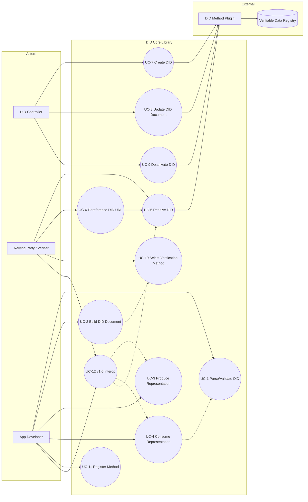

# DID Core v1.0/v1.1: Use Cases

> Reference: the FR identifiers in `00-feature-definition.md`. Each use case states the FRs it satisfies.

---

## 1. Actors

| Actor | Description | Spec term |
|-------|-------------|-----------|
| **DID Controller** | Entity (person/organization/device) with authority to change the DID and DID document | §DID Controller |
| **DID Subject** | The entity identified by the DID. May or may not be the same as the controller | §DID Subject |
| **Relying Party / Verifier** | Entity that consumes DID documents to make trust decisions (web app, IoT hub, etc.) | §Architecture |
| **DID Resolver** | Software that takes a DID and returns a DID document | §DID Resolver |
| **DID URL Dereferencer** | Takes a DID URL and returns a resource | §DID URL Dereferencer |
| **DID Method (Plugin)** | Component that implements CRUD for a specific method-name | §Methods |
| **Verifiable Data Registry (VDR)** | System that stores, updates and deactivates DIDs/documents (ledger/DB/DNS, etc.) | §Architecture |
| **Application Developer** | Developer using this library | none |

---

## 2. Use Case Overview (Use Case Diagram)

---

## 3. Use Case Details

### UC-1: Parse and Validate DID / DID URL
- **Actors:** App Developer, Resolver
- **FR:** FR-S1, FR-S2, FR-S3, FR-S4, FR-S6
- **Precondition:** An input string exists
- **Main flow:**
  1. Receive the input string.
  2. Check the `did:` scheme, extract `method-name` (validate lowercase letters and digits), then validate `method-specific-id`.
  3. If it is a DID URL, split `path`/`query`/`fragment` and validate each RFC3986 component.
  4. Return the parsed struct.
- **Alternative flows:**
  - 3a. A character outside `idchar` is found: return `ErrInvalidSyntax`.
  - 3b. The context is subject/controller but the input contains `?`/`#`: `ErrIdentifierRestriction`.
- **Postcondition:** A valid `DID`/`DIDURL` value or a typed error.

### UC-2: Build a DID Document
- **Actors:** App Developer, Controller
- **FR:** FR-D1 to D7, FR-P3
- **Main flow:**
  1. Set the required `id` (DID).
  2. Add optional properties (`controller`, `alsoKnownAs`, `service`, `verificationMethod`, the 5 relationships).
  3. When adding a VM, `id` (DID URL), `type` and `controller` (DID) are required; validate the key as `publicKeyMultibase` XOR `publicKeyJwk`.
  4. When adding a Service, `type` and `serviceEndpoint` (URL validated) are required; `id` is optional (if present, unique within the document; required when the production target is V10, see FR-V3).
  5. If validation passes, return an immutable DID document.
- **Alternatives:** 3a. Both key formats present: `ErrKeyFormatConflict`. 4a. Endpoint string is not a valid URL: `ErrInvalidServiceEndpoint`.

### UC-3: Produce a Representation
- **Actors:** App Developer, Controller, Resolver
- **FR:** FR-R1, FR-R3, FR-R4, FR-R5, FR-P3
- **Main flow:**
  1. Input: DID document data model plus representation-specific-entries.
  2. JSON producer: all entries in the root Object, datetime in UTC `Z`.
  3. When JSON-LD is requested, ensure the first `@context` element is the target version URL (V11: `…/did/v1.1`, V10: `…/did/v1`; FR-V3).
  4. Secret key material is excluded by default (included only on opt-in).
  5. Return serialized bytes plus the version-specific media type (V11: `application/did`, V10: `did+ld+json`/`did+json`).
- **Alternative:** 2a. Non-conforming DID/document: refuse to produce (`MUST NOT produce non-conforming`).

### UC-4: Consume a Representation
- **Actors:** App Developer, Verifier, Resolver
- **FR:** FR-R2, FR-R3, FR-R5, FR-D7
- **Main flow:**
  1. Input: bytes plus a media type string (accept `application/did` plus legacy `did+json`/`did+ld+json`; FR-V2).
  2. Detect the version from the media type and `@context[0]` (FR-V1, `09` §4). Check that the root is a JSON Object.
  3. Classify entries: *known* representation-specific entries such as `@context` go to representation-specific-entries (rule 3); *unrecognized* non-representation-specific properties are added as data model extension properties (rule 4).
  4. If JSON-LD, drop undefined terms.
  5. Return the data model.
- **Alternatives:** 2a. Root is not an Object: error. 2b. Non-conforming document: must error.

### UC-5: Resolve a DID
- **Actors:** Verifier, Resolver, Method Plugin
- **FR:** FR-X1, FR-X2, FR-M2, FR-M6
- **Precondition:** A Method is registered for the method-name
- **Main flow:**
  1. Call `resolve(did, resolutionOptions)`.
  2. Parse the DID (UC-1). Look up the Method in the registry by method-name.
  3. Call Method.Read: obtain the document from the VDR and verify authenticity.
  4. Return `didDocument` + `didResolutionMetadata` + `didDocumentMetadata`.
- **Alternatives:**
  - 2a. Parsing fails: metadata.error.type = `…#INVALID_DID` (RFC9457, `07` §4).
  - 2b. Method not registered: `…#METHOD_NOT_SUPPORTED`.
  - 3a. No document: `…#NOT_FOUND`. Deactivated: not an error, `didDocumentMetadata.deactivated=true`.
  - (On the v1.0 contract path, the adapter maps to string codes such as `invalidDid`/`notFound`; see UC-12.)

### UC-6: Dereference a DID URL
- **Actors:** Verifier, Dereferencer
- **FR:** FR-X3, FR-S3, FR-M2
- **Main flow:**
  1. Call `dereference(didUrl, options)`.
  2. Perform UC-5 on the DID part to obtain the DID document.
  3. If there is a `fragment`, select the VM/service in the document whose `id` matches (compare after making relative DID URLs absolute).
  4. Apply service dereferencing rules (if any).
  5. Return `contentStream` + `dereferencingMetadata` + `contentMetadata`.
- **Alternative:** 3a. No fragment match: `…#NOT_FOUND` (RFC9457).

### UC-7: Create a DID
- **Actors:** DID Controller, Method Plugin
- **FR:** FR-M1, FR-M5, FR-P1
- **Main flow:**
  1. The Controller calls `Method.Create(inputDoc, options)`.
  2. The Method generates/registers keys and computes the method-specific-id (**unique within the method**, so the resulting DID is globally unique).
  3. Record it in the VDR with integrity protection.
  4. Return the final conforming DID document plus the DID.
- **Alternative:** Authorization fails: `ErrUnauthorized`.

### UC-8: Update a DID Document
- **Actors:** DID Controller, Method Plugin
- **FR:** FR-M3, FR-M5, FR-P1
- **Main flow:**
  1. The Controller submits the changed document plus proof of authorization.
  2. The Method verifies authorization (controller/authentication/capabilityInvocation).
  3. Update the VDR; new versionId/updated metadata.
- **Alternative:** If the method does not support update: `ErrNotSupported`.

### UC-9: Deactivate a DID
- **Actors:** DID Controller, Method Plugin
- **FR:** FR-M4, FR-M5
- **Main flow:**
  1. The Controller calls `Method.Deactivate(did, options)`.
  2. After verifying authorization, mark it deactivated in the VDR.
  3. Subsequent Resolve returns metadata `deactivated=true`.
- **Alternative:** Method does not support it: `ErrNotSupported`.

### UC-10: Select a Verification Method by Purpose
- **Actors:** Verifier
- **FR:** FR-D3, FR-D4, FR-S3
- **Main flow:**
  1. In the resolved DID document, look up the relationship for the purpose (authentication/assertion, etc.).
  2. If an element is a reference (DID URL string), look up the embedded VM in `verificationMethod` (making relative URLs absolute).
  3. If an element is an embedded VM, use it as is.
  4. Parse the key format (`publicKeyMultibase`/`publicKeyJwk`) and use it for verification.
- **Alternative:** Reference not found in the document: `ErrDanglingReference`.

### UC-11: Register a DID Method
- **Actors:** App Developer
- **FR:** FR-M6, NFR-2
- **Main flow:**
  1. Call `Registry.Register(methodName, methodImpl)`.
  2. Check for a duplicate method-name.
  3. Subsequent Resolve/CRUD calls are routed to that method.
- **Alternative:** Duplicate registration: `ErrMethodAlreadyRegistered`.

### UC-12: v1.0 Interop
- **Actors:** Verifier, Legacy Client (v1.0 consumer / Universal Resolver client), App Developer
- **FR:** FR-V1 to V5
- **Precondition:** None (the core always accepts both versions)
- **Main flow:**
  1. **Consume a v1.0 document**: input with `did+json`/`did+ld+json` or `@context[0]==…/did/v1` is detected as V10 and normalized into the single core model (extension of UC-4).
  2. **Produce a v1.0 document**: specify `SpecVersion=V10` to serialize with the v1 context and a legacy media type. Documents without `service.id` are rejected (v1.0 §5.4 MUST).
  3. **v1.0 contract resolution**: a legacy client calls `compat.V10Resolver.resolveRepresentation()`, which performs an internal v1.1 resolve, V10 production, and RFC9457 to string error mapping (`09` §6.1).
  4. The detected version is reported to the caller as `ConsumeInfo.DetectedVersion`.
- **Alternatives:**
  - 2a. Target is V10 but `service.id` is missing: `ConformanceError`.
  - 3a. `serviceType` parameter used on the v1.0 path: `featureNotSupported` (string).
  - 3b. `hl` parameter: accepted by the adapter (not passed to the core, `09` §6.2).

---

## 4. Use Case to FR Matrix

| UC | FR |
|----|-----|
| UC-1 | S1,S2,S3,S4,S6 |
| UC-2 | D1,D2,D3,D4,D5,D6,D7,P3 |
| UC-3 | R1,R3,R4,R5,P3 |
| UC-4 | R2,R3,R5,D7 |
| UC-5 | X1,X2,M2,M6 |
| UC-6 | X3,S3,M2 |
| UC-7 | M1,M5,P1 |
| UC-8 | M3,M5,P1 |
| UC-9 | M4,M5 |
| UC-10 | D3,D4,S3 |
| UC-11 | M6 |
| UC-12 | V1,V2,V3,V4,V5 |
