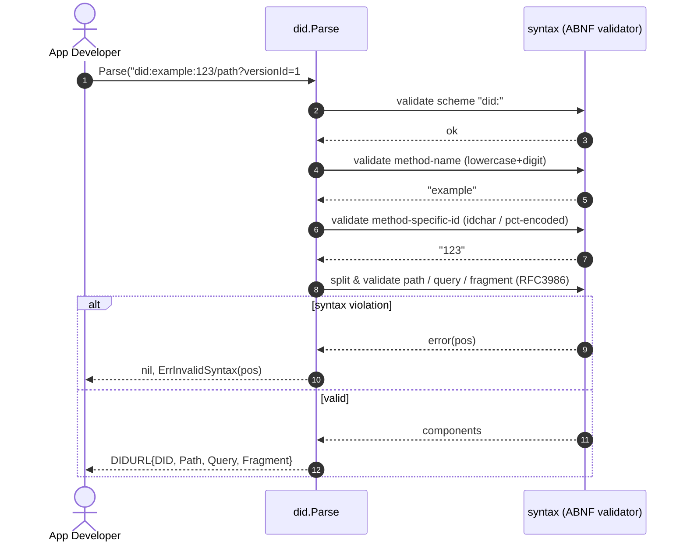
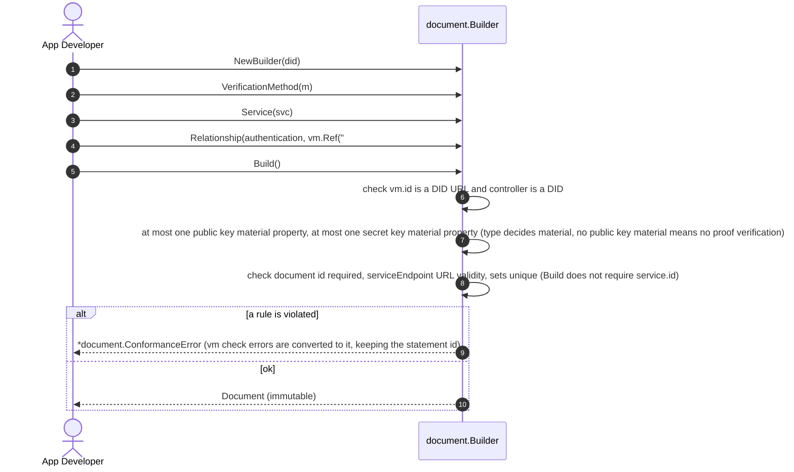
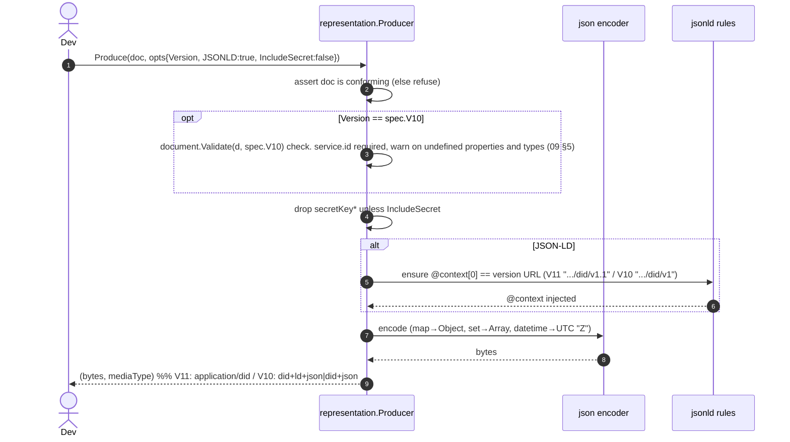
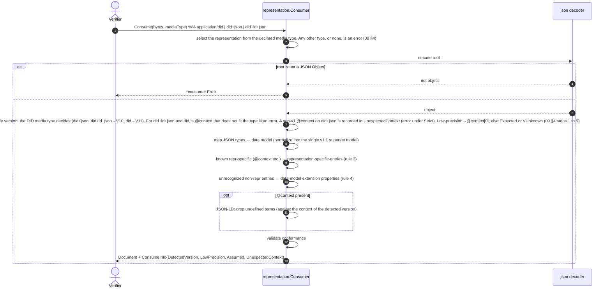
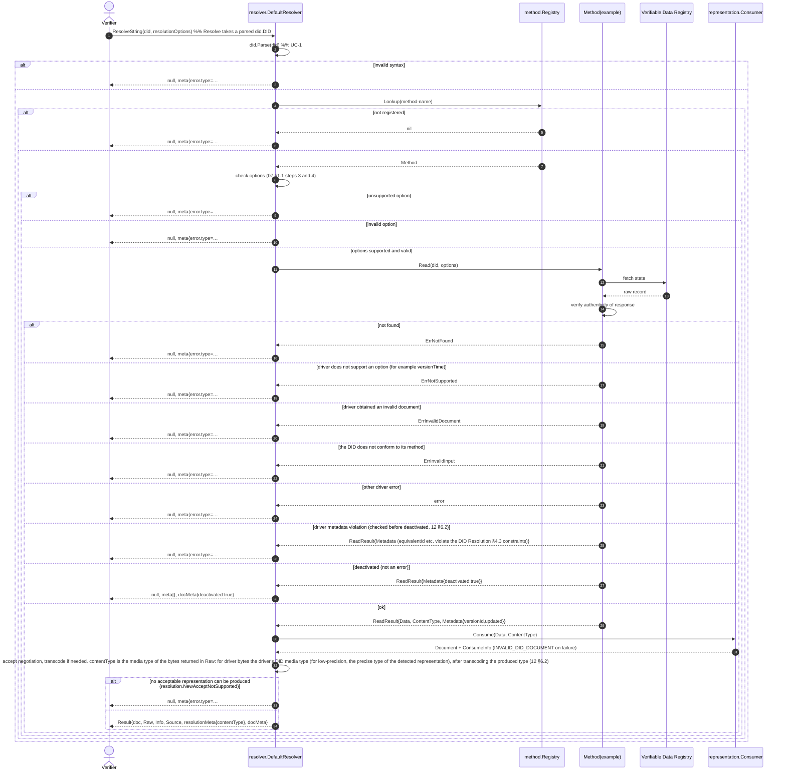
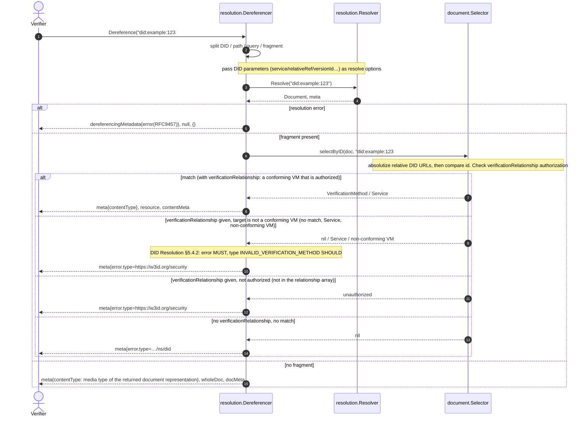
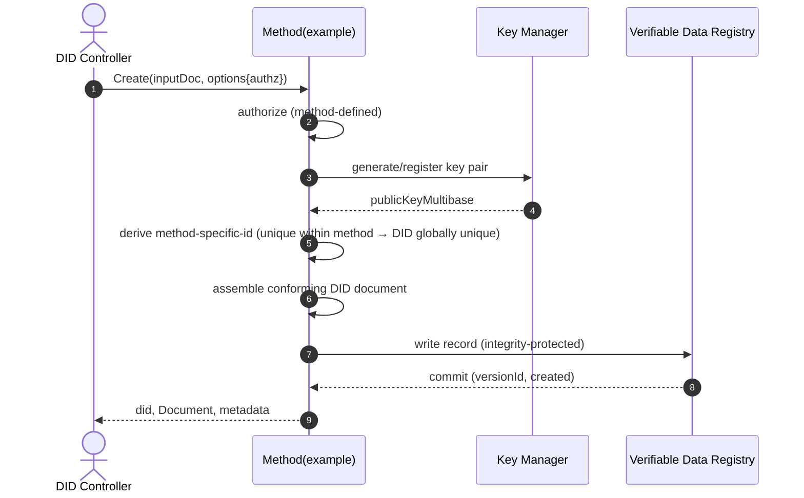
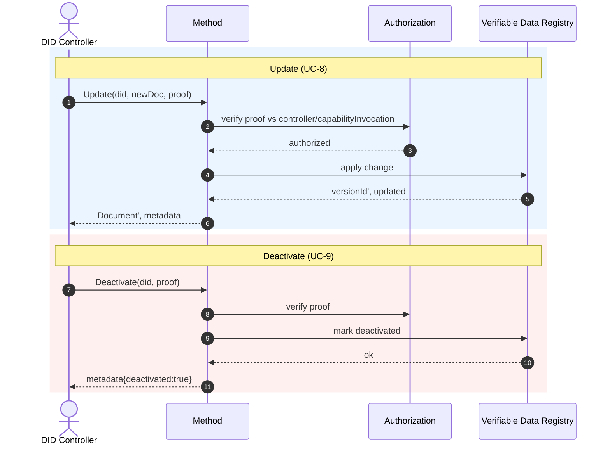
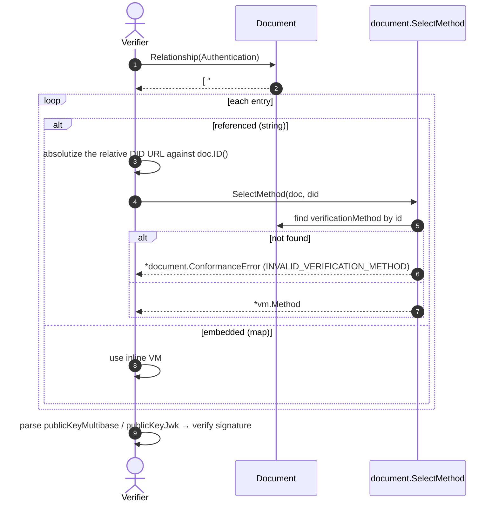
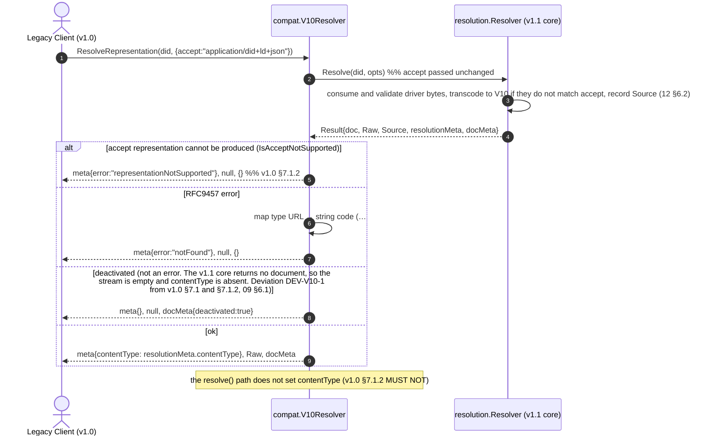

# DID Core v1.0/v1.1: Sequence Diagrams

> Each sequence corresponds to a use case in `01-use-cases.md`. The diagrams are written in Mermaid and render on GitHub and in compatible viewers.

---

## 1. Parse and validate a DID (UC-1)

---

## 2. Build and validate a DID document (UC-2)

---

## 3. Produce a representation (UC-3)

---

## 4. Consume a representation (UC-4)

---

## 5. Resolve a DID (UC-5)

---

## 6. Dereference a DID URL (UC-6)

---

## 7. Create a DID (UC-7)

---

## 8. Update and deactivate (UC-8 / UC-9)

---

## 9. Select a verification method by purpose (UC-10)

---

## 10. v1.0 contract: resolveRepresentation (UC-12, FR-V4)

This is the `resolution/compat.V10Resolver` flow for legacy callers that need the v1.0 REC §7.1 contract. See [`09`](09-v1.0-compat.md) §6 for details.

