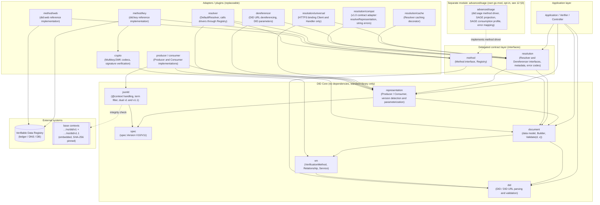
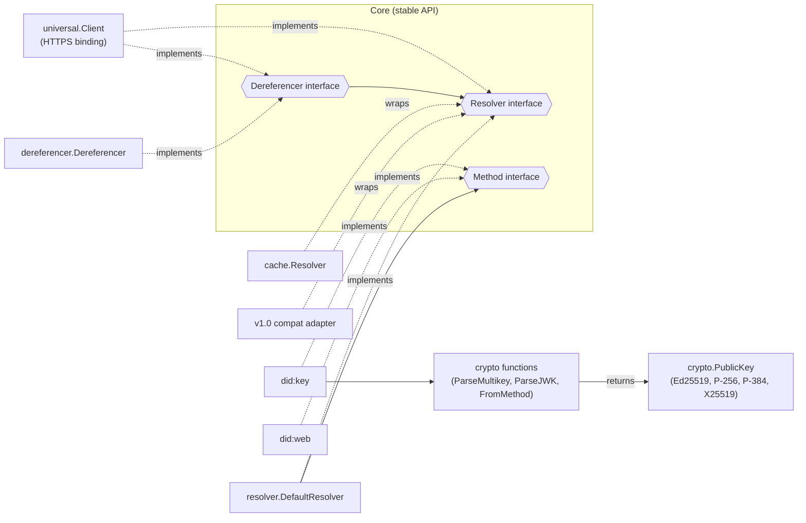
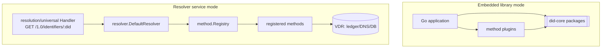

# DID Core v1.0/v1.1: Component Diagram

> The spec's delegation boundaries (A: Resolution, B: CID, C: single media type) are reflected directly as component boundaries. The core has no dependencies, and external delegation is isolated behind interfaces. **v1.0 support (D)** does not split the core in two; it appears only as representation parameters, validation profiles and the `resolution/compat` adapter ([`09`](09-v1.0-compat.md)).

---

## 1. Overall Component Structure

> The implementation package layout (players, shared types, layers) is defined by [`14`](14-implementation-architecture.md), which supersedes this section where they differ.

All components below except the `advanced/sage` subgraph belong to the root module `github.com/sage-x-project/did-go` (standard core). `advanced/sage` is a separate module with its own `go.mod` ([`12`](12-standard-core-and-sage-extension.md) §3). No package in the root module imports it.

---

## 2. Component Responsibilities

| Component | Responsibility | FR | Depends on |
|-----------|----------------|----|------------|
| `spec` | `spec.Version` (V10/V11/VUnknown), version-specific context URLs | FR-V1 | none |
| `did` | DID/DID URL ABNF parsing and validation, relative URL absolutization, percent-encoding (version independent) | FR-S1 to S6 | none |
| `document` | DID document data model (INFRA types, v1.1 superset), Builder, `Validate(d, v)` (given `spec.V10`, it checks the DID Core 1.0 rules), immutable documents, relationship/reference selectors, the didDocumentMetadata type `document.Metadata` (including equivalentId/canonicalId, shared by method and resolution) | FR-D1,D2,D7,V3 | `did`, `vm` |
| `vm` | VerificationMethod/Service/5 Relationship structs, CID constraint validation (at most one public and at most one secret key material property, material chosen by type, etc.) | FR-D3,D4,D5,P3 | `did`, `internal/multiformats` (the Multikey prefix and length table lives in `vm` as pure data) |
| `representation` | JSON Producer/Consumer (`application/did` plus 2 legacy types), version detection, production of the version that `ProduceOptions.Version` selects, deterministic lossless serialization | FR-R1,R2,R4,R5,V1,V2,V3 | `document`, `spec` |
| `jsonld` | `@context` injection and validation (per version), undefined term drop, base context integrity (dual v1 and v1.1) | FR-R3,R6,V5 | embedded contexts |
| `resolution` | Resolver/Dereferencer interfaces, resolutionOptions, resolution metadata, error catalog, `DocumentMetadata` (alias of `document.Metadata`) | FR-X1 to X4,D6 | `did`, `document`, `representation`, `spec`, `vm` |
| `method` | Method interface (CRUD + authz), method-name Registry | FR-M1 to M6 | `did`, `document` |
| `method/key`,`method/web` | Reference method implementations | FR-M1 to M6 | `method`, `crypto` (used by `method/key` only), VDR |
| `crypto` | Reads Multikey and JWK values into a `PublicKey` (`ParseMultikey`, `ParseJWK`, `FromMethod`) and verifies signatures (CID delegation) | FR-D3,P1 | `vm`, `internal/multiformats`, standard library crypto packages |
| `resolution/universal` | The DID Resolution HTTPS binding only. `Client` calls a remote resolver as a `resolution.Resolver` and `resolution.Dereferencer`, and `Handler` exposes any Resolver and Dereferencer as an HTTP endpoint. It does not resolve DIDs itself | FR-X5 | `resolution`, `representation` |
| `resolution/cache` | A caching decorator around any `resolution.Resolver`. It handles the `noCache` option | FR-X1,X2 | `resolution` |
| `dereferencer` | DID URL dereferencing and the DID parameters (`service`, `serviceType`, `relativeRef`, `versionId`, `versionTime`) | FR-X2,X3 | `resolution`, `representation` |
| `resolution/compat` | The v1.0 REC §7 contract adapter. It provides `ResolveRepresentation()`, maps RFC9457 errors to string errors and accepts `hl` | FR-V4 | `did`, `document`, `resolution`, `spec` |

---

## 3. Interface Boundaries (Ports & Adapters)

**Design principles**
- **Hexagonal (Ports & Adapters):** the core exposes only interfaces (ports). Methods, crypto and resolvers are injected as adapters. This serves NFR-2 (extensibility) and NFR-3 (dependency-free core).
- **Isolation of delegation boundaries:** if DID-RESOLUTION or CID details change, the core data model stays unchanged. Only the `resolution`/`crypto` adapters are replaced.
- **One-way dependencies:** `adapters → contract → core`. The core does not know the adapters (inversion).

---

## 4. Deployment View

Both deployment forms reuse the same core. Service mode exposes the DID-RESOLUTION HTTP binding (`application/did` responses) through the `Handler` of `resolution/universal`. **v1.0 clients** have no separate endpoint; they negotiate a V10 representation on the same binding through the Accept header (`application/did+ld+json`/`did+json`). If the driver cannot produce that format, the core transcodes the validated document to V10 and keeps the driver original in `Source` (`09` §6.3, `12` §6.2).
