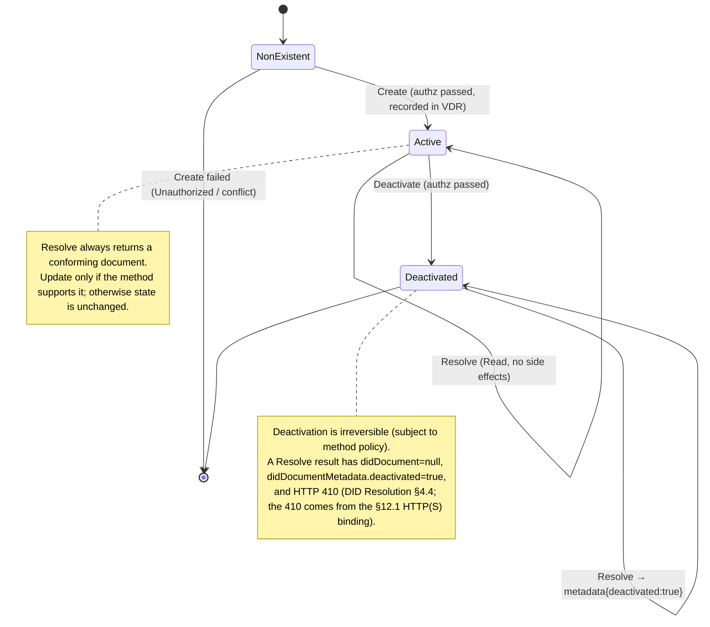
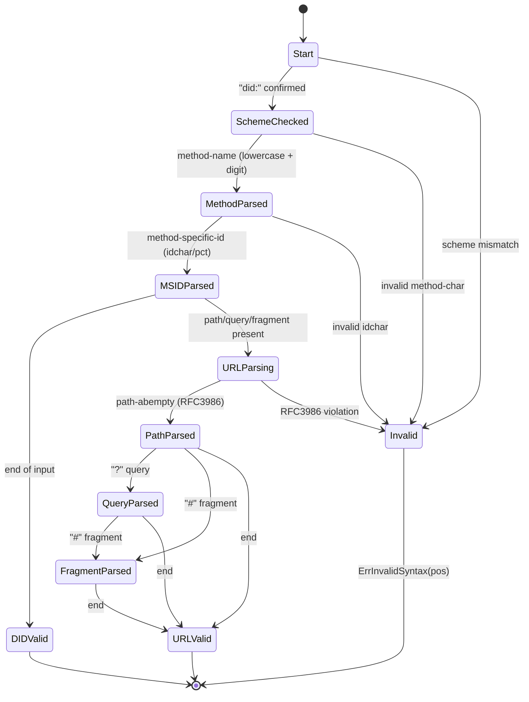
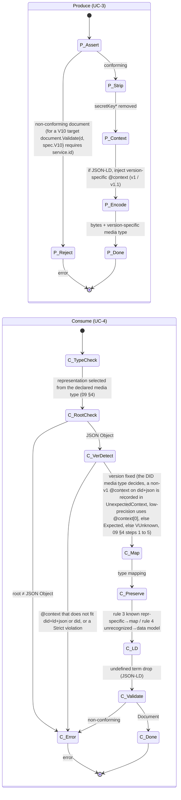
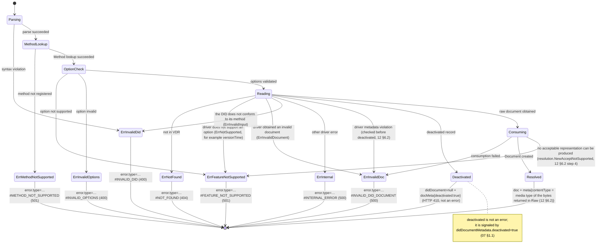
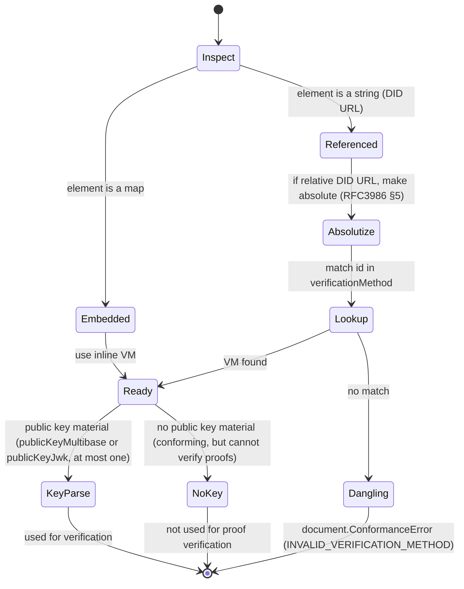

# DID Core v1.0/v1.1: State Diagrams

> Defines the DID lifecycle (§Method Operations) and the library's internal processing states (parsing, representation, resolution) as state machines.

---

## 1. DID Lifecycle (Create → Update → Deactivate)

Corresponds to the method CRUD operations (§Method Operations).

---

## 2. DID / DID URL Parsing States (UC-1)

---

## 3. Representation Processing States (Produce / Consume)

---

## 4. Resolve Processing States (UC-5)

---

## 5. Verification Method Reference Resolution States (UC-10)

---

## 6. State Machine to Spec Basis Mapping

| State machine | Spec basis | FR |
|---------------|------------|-----|
| §1 Lifecycle | §Method Operations (Create/Read/Update/Deactivate) | FR-M1 to M4 |
| §2 Parsing | §DID Syntax / §DID URL Syntax ABNF | FR-S1 to S3 |
| §3 Representation | §Production and Consumption, §JSON, §JSON-LD; version detection and profiles from v1.0 REC §5.4/§6 plus `09` §4 and §5 | FR-R1 to R4, FR-V1 to V3 |
| §4 Resolve | DID-Resolution resolve algorithm, RFC9457 errors (07 §1.1, §4) | FR-X1,X4 |
| §5 VM reference | §Verification Relationships, §Relative DID URLs, CID Retrieve VM (06 §3) | FR-D4,S3 |
