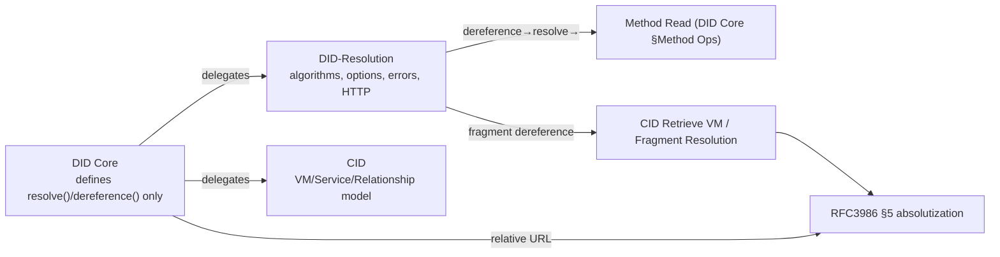

# Document Verification Report

> Since this audit, DID Resolution has been re-pinned to DID Resolution v1.0, W3C Candidate Recommendation Draft, 2026-10-01 (https://www.w3.org/TR/2026/CRD-did-resolution-1.0-20261001/), and [07-did-resolution-contract.md](07-did-resolution-contract.md) records the resulting corrections.

> Scope: first pass, `docs/00` to `07` (§1 to §4); second pass, all of `00` to `09` plus the README after the v1.0 compatibility extension (§5 to §6).
> Method: **parallel comparison audit against the three source texts**, DID Core v1.1, CID 1.0 and the DID Resolution draft pinned at the time (one independent auditor per specification), plus a cross-review of the logical flow between the specifications. The second pass compared against the v1.0 REC (2022-07-19) text, checked consistency between documents, and ran three v1.1 regression audits in parallel.
> Summary of results: **0 CRITICAL.** 5 MAJOR and 6 MINOR issues were identified and **all were applied**. In the logical flow between specifications, 6 real tensions or contradictions were confirmed. Most of them are **internal inconsistencies of the delegated specifications themselves**, and they were kept in the documents as flags.

---

## 1. Requirement 1: content written differently from the specifications (comparison audit results)

Three auditors compared every normative claim in the documents (MUST, types, cardinality, algorithms, error names, encoding values) one to one against the source texts. The confirmed mismatches and the actions taken are below.

### MAJOR (applied)

| # | Location | What the document said | Specification | Action |
|---|----------|------------------------|---------------|--------|
| M1 | `05` §3.3, `00` FR-D5 | **All three Service fields are required** | CID §2.1.4: `id` is **optional** (sub-definition line 1057; the specification examples also have no id). Only `type` and `serviceEndpoint` are required | Changed `id` to optional and kept the no-duplicates rule. `06` §8 was already correct |
| M2 | `05` §3.2 and §9, `00` FR-D6 | equivalentId/canonicalId are in didDocumentMetadata as their "normative location in DID Core" | DID Core §Equivalence describes them as **properties "inside the document"** (Security chapter). The formal definition exists only in DID Resolution didDocumentMetadata | Kept the metadata placement (where the formal definition is) but **removed the attribution to DID Core**, and recorded it in §2 as a tension between specifications |
| M3 | `00` FR-D7, `05` §3.2 and §4, `01` UC-4, `02` §4, `04` §3 | Unknown entries are preserved in representation-specific-entries | Consumer rules 3 and 4 define **two buckets**: rule 3 = *known* representation-specific entries (@context and so on) go to the map; rule 4 = *unrecognized* non-representation-specific entries are added to the **data model** | Split into two buckets (`reprEntries` / `extensions`) |

> M2 and M3 are substantive errors that the auditors pointed out. M3 in particular corrected the false equation "unrecognized = representation-specific", so that extension properties are not lost from the data model.

### MINOR (applied)

| # | Location | Content | Action |
|---|----------|---------|--------|
| m1 | `01` UC-7, `02` §7 | Described method-specific-id as "globally unique" | Corrected: the msid is **unique within the method**; global uniqueness is a property of the **DID** (§Method Syntax) |
| m2 | `00` FR-P4 | Attributed multiple DIDs and selective disclosure to §Privacy Requirements (normative) | The only normative content is the MUST to discuss RFC6973 §5. The rest was re-attributed to §Privacy Considerations (informative) |
| m3 | `00` §1 | "Four conformance classes" | §conformance defines **5 entities** (producer and consumer are separate). Clarified as "5 entities grouped into 4 deliverables" |
| m4 | `07` §1.1 step 7 | `contentType` in didDocumentMetadata | The specification's algorithm text says so, but it contradicts §5 and the OpenAPI. **didResolutionMetadata** is canonical; added caution 4 |
| m5 | `07` (new) | OpenAPI `deactivated:string` was not flagged | boolean is canonical; added caution 5 about the OpenAPI error |
| m6 | `04` §4, `02` §5 | FEATURE_NOT_SUPPORTED / INVALID_OPTIONS missing from the resolve state diagram | Added states for the option validation branch |

### High-risk items **confirmed correct** by the audit (no change)
- **The whole CID multicodec prefix table** (public and secret key byte values and lengths): Ed25519 `0xed01`/34B through SM2 `0x9026`/34B all match the source.
- CID Retrieve VM with its 12 steps and 5 error names, Fragment Resolution, the quotation of the key material XOR rule, and the prohibition of JWK private members.
- All 9 DID Resolution error names plus the 2 CID errors and the HTTP status mapping, the absence of `resolveRepresentation()`, `deactivated` = metadata + 410, the signatures, options, DID parameters and HTTP binding.
- The reproduction of the DID Core ABNF, Core Properties, the single `application/did`, datetime `Z`, the `@context` first-element rule, the base context SHA-256, and the Method Operations MUST.

---

## 2. Requirement 2: review of the logical flow between specifications

The three specifications are connected by a **delegation chain**: `DID Core` (identifier, data model, representation) delegates the data model to `CID` and resolution to `DID-Resolution`. At these boundaries, the consistency of the logical flow and the real tensions were reviewed.

### 2.1 Flows confirmed consistent (no problem)

- **Dereference delegation chain**: DID Resolution `dereference()` → `resolve()` (DID Core method Read) → CID `Retrieve VM` / `Fragment Resolution`. The inputs and outputs of each step fit together, and the rule that DID parameters are passed as resolve options is also consistent.
- **Absolutizing relative URLs**: DID Core §Relative DID URLs and CID Retrieve VM both reference RFC3986 §5, so they converge on a single algorithm.
- **Media type layers**: `application/did` (DID document) / `application/cid` (CID document) / `application/did-resolution` and `application/did-url-dereferencing` (result wrappers). Fragment processing is delegated to the media type of the resource, so the layers are not confused.
- **Error namespace boundary**: DID Resolution errors = `https://www.w3.org/ns/did#…`, CID errors = `https://w3id.org/security#…`. Both namespaces appear together in fragment dereferencing, and the documents attribute each correctly.
- **Separating authentication from authorization**: the CID distinction between `authentication` ("who are you") and `capabilityInvocation/Delegation` ("are you allowed") is reflected in UC-10 and §7.

### 2.2 Confirmed tensions between and within specifications (kept in the documents as flags)

These are **not document errors but unresolved inconsistencies in the specifications themselves**. Instead of arbitrarily deleting one side, the documents record the chosen canonical reading and the reason.

| # | Point of tension | Conflict | Adopted canonical reading | Location |
|---|------------------|----------|---------------------------|----------|
| T1 | **Where equivalentId/canonicalId belong** | DID Core §Equivalence (properties inside the document) vs DID Resolution (formal definition in didDocumentMetadata) | didDocumentMetadata (the formal definition, JSON and OpenAPI are there) | `05` §3.2, `07` §5, M2 |
| T2 | **Composing the serviceEndpoint URL** | DID Resolution normative text (RFC3986 §5 replacement) vs the worked example (path appended) | RFC3986 §5 (normative): for an absolute-path reference, the base path is replaced | `07` §2.1 caution 6 |
| T3 | **Placement of contentType** | resolve algorithm step 7 (didDocumentMetadata) vs the property definition and OpenAPI (didResolutionMetadata) | didResolutionMetadata | `07` caution 4 |
| T4 | **Type of deactivated** | normative HTML (boolean) vs OpenAPI (string) | boolean | `07` caution 5 |
| T5 | **Whether Service id is required** | CID parent sentence (id required) vs sub-definition and examples (id optional) | optional | `06` §8, M1 |
| T6 | **Data type of expires/revoked** | CID prose (`dateTimeStamp`) vs JSON-LD context (`dateTime`) | the prose (dateTimeStamp); Go `time.Time` is safe for both | `06` §2.2 |
| T7 | **`@context` and `contentType` in the result example** | DID Resolution v1.0 CRD Example 21 (`#did-resolution-result`, informative) pairs a 1.0 `@context` (`…/did/v1`) with `contentType` `application/did` vs the production-and-consumption MUST of DID Core 1.0 and DID 1.1, which makes the media type input decide the representation, and DID 1.1 §6.2.3, which sets the first `@context` value to `…/did/v1.1` for production for JSON-LD processing. Applying that rule to the `@context` of an `application/did` document is did-go's interpretation (`12` §6.1) | the normative MUST together with did-go's interpretation; under that interpretation a conforming consumer rejects this combination as an error | `12` §6.1, `09` §4, `07` caution 9, `10` §2.5 D3 |
| T8 | **Multibase `u` encoding** | CID §2.4 requires every Multibase value, including base-64-url-no-pad (`u`), to be encoded with the CID §3.1 integer base-conversion algorithm ("MUST apply the algorithm in Section 3.1 Base Encode"), which gives a different result from RFC 4648 base64url bit packing for most inputs, while common Multibase practice for `u` follows RFC 4648 | did-go follows CID §3.1 for `z` and `u` (the spec MUST); JOSE base64url (RFC 4648) is a separate function. A `u` value written by an RFC 4648 implementation may decode differently. Multikey uses only `z`, so verification keys are not affected | `06` §9 |
| T9 | **BLS12-381 G2 secret key prefix** | CID §2.2.2 gives the prefix `0x8030` and calls it "the varint expression of 0x130a", but the varint of `0x130a` is `0x8a26` | did-go accepts both prefixes for that key type and records the inconsistency; it produces no BLS12-381 secret keys | `06` §5 |
| T10 | **Serializing every entry vs undefined terms** | production-and-consumption.10 requires a producer to serialize every entry of the data model and return the serialization ("MUST serialize all entries"). DID Core 1.0 §6.3.1 (production-0.5) and DID 1.1 §6.2.3 (json-ld-processors.6) recommend that a JSON-LD producer not produce a document with terms its `@context` does not define ("SHOULD NOT produce a DID document that contains terms not defined via the @context"). A producer satisfies both only by refusing, but a document with undefined terms is still conforming, so refusing it fails the MUST | did-go writes every entry by default (MUST) and refuses when given `producer.RejectUndefinedTerms()` (SHOULD NOT). An inspector's recommendation-level finding on these statements is an accepted deviation | `05` §4, `09` §7 |

An **intended** inconsistency stated in the vocabulary file was also confirmed: the naming difference between the short terms `capabilityDelegation` / `capabilityInvocation` / `keyAgreement` and the property ids (`…Method`) is specified as "do not treat as an error". Consumers must accept both forms (vocabulary.yml `known_as`).

### 2.3 Conclusion on the logical flow
The **delegation boundaries and data flow between the specifications are structurally sound**. Every tension found is either (a) an internal inconsistency in DID Resolution, which was a draft at the time (T2, T3, T4), or (b) a case where the "home" of a property spans two specifications at a delegation boundary (T1, T5). These are not points where the implementation would fail; they are **points that need a choice of canonical reading**. The canonical reading and the reason are stated for each point, so the implementation can proceed deterministically.

---

## 3. Residual risks and recommendations

1. **DID Resolution was a draft at the time of this audit.** T2, T3 and T4 need to be rechecked when the upstream specification is finalized. The design that isolates this behind the `resolution/universal` adapter absorbs such changes.
2. **CID `dateTimeStamp` vs `dateTime` (T6)**: sub-second precision is the issue. If producers normalize to UTC without sub-seconds (consistent with the DID Core JSON rules), both are satisfied.
3. **Conformance tests during implementation** prevent regression of M1, M3 and T1: (a) a service document without an id passes, (b) a round-trip test in which unrecognized properties are preserved in the data model, (c) a path that reads equivalentId from metadata.

## 4. Summary of changes (files updated)
`00` (FR-D5/D6/D7, FR-P4, §1), `01` (UC-4, UC-7), `02` (§4, §7), `04` (§3, §4), `05` (§3.2, §3.3, §4, §9, ADR), `07` (cautions 4, 5, 6, §1.1, §2.1). The audit confirmed `06` to be **flawless**, so it was not changed.

## 5. Addendum (leftovers found during the v1.0 compatibility work, fixed)
- **M1 leftover**: step 4 of `01` UC-2 still said "Service `id` is required" (the audit's M1 fix had only been applied to `00` and `05`). Corrected to optional.
- **Error notation leftover**: the alternative flows of `01` UC-5/UC-6 still used legacy camelCase strings (`invalidDid` and so on). Corrected to the RFC9457 `…#CODE` notation (the v1.0 string contract is stated as the adapter path in UC-12 / `09` §6).
- After this, the dual-version (v1.0 + v1.1) support design was added. See [`09-v1.0-compat.md`](09-v1.0-compat.md). Because v1.0 REC §7.1.3 places equivalentId/canonicalId in didDocumentMetadata, it was confirmed that **adopting metadata for T1 is also consistent with v1.0**.

---

## 6. Second-pass verification (after the dual-version extension; three audits in parallel, all applied)

> Audit A: every v1.0 claim in `09` against the v1.0 REC text. Audit B: cross-consistency of the 11 documents. Audit C: regression against v1.1, CID and DID Resolution.
> Result: **0 factual errors (regressions) against the specifications.** The high-risk items (the REC defines only 5 error codes, contentType MUST NOT, service.id MUST, the `hl` list and the absence of `serviceType`, the §7.1.3 metadata placement, media types E.1/E.2, the two-bucket consumer rule, the rationale for ADR-10/13) were confirmed to match the source text verbatim.

### Findings and actions (all applied)

| # | Severity | Location | Content | Action |
|---|----------|----------|---------|--------|
| R1 | MAJOR | `09` §8 | The source of FR-V was miswritten as `00 §2.7` (numbering left behind after §2.6 was added) | Corrected to §2.6 |
| R2 | MAJOR | `05` §4 | `JSONRepresentation.Consume` returned 2 values, contradicting the new `Consumer` interface (3 values); it would not compile | Unified as `(*Document, ConsumeInfo, error)` |
| R3 | MINOR | `09` §2.4 and §10, `05` §6.1, `00` FR-V4 | The "**on success**" condition (REQUIRED if resolution is successful) was missing from the contentType REQUIRED rule, which would cause wrong tests on the error path | Added the condition |
| R4 | MINOR | `09` §6, `05` §6.1, `00` FR-V4 | The MUST NOT on the v1.0 `accept` option in the resolve path (§7.1.1) was not handled | Added a rule that the adapter ignores it and warns |
| R5 | MINOR | `02` §5 | The caller of Consume was drawn as Method, which conflicts with `05` DefaultResolver and `04` §4 (the Resolver consumes) | Moved the caller to R |
| R6 | MINOR | `02` §6 | Fragment "not found" and "not authorized" were merged into one branch and wrongly attributed to INVALID_DID_URL; `07` §2.1 says not dereferenced → NOT_FOUND | Split into not found → NOT_FOUND and not authorized → INVALID_RELATIONSHIP… (revised: with verificationRelationship, no match is also INVALID_VERIFICATION_METHOD, `02` §6) |
| R7 | MINOR | `02` §4, `04` §3 | Version detection based on `@context` was placed **before** the root decode (impossible without parsing) | Split into two stages: a first signal (media type, before decode) and confirmation (@context, after decode) |
| R8 | MINOR | `06` §11 vs `05` §3.3 | Conflicting vm.Method mappings (strings vs enforced types), left over from the first pass | Stated the layer relationship: 06 §11 = generic CID reference, **05 §3.3 = canonical for the DID layer** |
| R9 | MINOR | `03` §2, README | Where FR-D6 belongs (document → resolution), "11 UCs" (→ 12) | Corrected |
| R10 | NIT | `09` §2.5 and §6.2, `00` fact D | Missing note that `hl` is **non-normative** in the REC (also part of the argument in §6.2(b)) | Added the note |
| R11 | NIT | `09` §2.2 and §7, `00` FR-V5 | Refined the clause attribution of XOR (§5.2.1 + §5.2), and added v1.0 §9.15 (informative) as supporting evidence | Applied |
| R12 | NIT | `00` fact D | Stated the conformance layer: V10 output is a v1.0 conforming artifact (not a v1.1 conforming production) | Added |
| R13 | NIT | `05` §1 and header, `09` §4, `01`, `02` | Duplicate `method/` in the package tree, unified the "three branch points" wording, a redundant hint in detection rule 4, UC-12 edges and the Producer label | Cleaned up |

### Confirmed passing (second pass)
FR-V1 to V5 mean the same thing across documents (00, 01, 05, 09); the version detection precedence matches in 5 documents; the media type matrix matches in 6 places; the service.id rule ("optional in the core + required for V10 production") is consistent in 8 places; the error models are separated (RFC9457 = v1.1 path only, strings = compat path only); the V10Resolver signature is identical in 05 and 09; ADR 1 to 15 are consecutive and their references are valid; the T1 to T6 and M1 to m6 references exist; all 11 Mermaid diagrams are syntactically valid.
