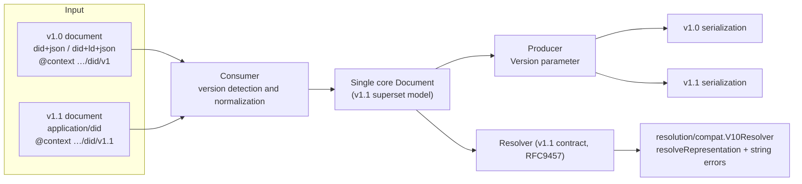

# DID Core v1.0 Compatibility: Dual-Version (v1.0 + v1.1) Support Design

> Purpose: the **canonical** normative comparison and compatibility design that lets this module **support DID Core v1.0 (REC) and v1.1 (CR) at the same time**.
> v1.0 basis: W3C *Decentralized Identifiers (DIDs) v1.0* Recommendation, 2022-07-19,
> <https://www.w3.org/TR/2022/REC-did-core-20220719/> (hereafter "v1.0 REC"; section numbers follow the REC)
> v1.1 basis: `did/index.html` + the delegated specifications ([`06`](06-cid-data-model.md) CID 1.0, [`07`](07-did-resolution-contract.md) DID Resolution v1.0, W3C Candidate Recommendation Draft, 2026-10-01)
>
> Every v1.0 normative quotation below was checked directly against the REC text (compared on 2026-07-22).

---

## 1. The exact relationship between the versions

v1.1 is a **maintenance revision on the same REC track** as v1.0 (v1.1 §Revision History: "Changes since the DID v1.0 Recommendation"). Compatibility differs by layer:

| Layer | v1.0 → v1.1 | Conclusion |
|-------|-------------|------------|
| DID/DID URL syntax (ABNF) | No change | **Fully compatible**: one parser |
| Abstract data model | v1.1 (via CID delegation) **adds** properties (`expires`/`revoked`/`secretKey*`), but **relaxes** the requirement on `service.id` (required → optional) | **v1.1 = superset**: one core model, branching by validation profile |
| Serialization envelope | `@context` URL and media type differ per version | **Branch**: parameterize the version in the producer and consumer |
| Resolution contract | v1.0 has it built into §7 (`resolveRepresentation()` exists, string errors) → v1.1 uses the DID Resolution specification (RFC9457) | **Branch**: v1.1 core + v1.0 adapter |

**Design principle: a single v1.1 superset core + version adapters at 3 branch points.** Do not build two implementations.



---

## 2. Normative difference matrix (confirmed against the source texts)

### 2.1 Syntax (no difference)

v1.0 §3.1/§3.2 and the v1.1 ABNF are identical: `did = "did:" method-name ":" method-specific-id`, `method-char = %x61-7A / DIGIT`, `idchar`, `did-url = did path-abempty ["?" query] ["#" fragment]`. **FR-S\* are version-independent.**

### 2.2 Data model

| Item | v1.0 REC | v1.1 (CID delegation) | Compatibility handling |
|------|----------|-----------------------|------------------------|
| Service `id` | §5.4: "Each service map **MUST contain `id`, `type`, and `serviceEndpoint`**", so **required** | CID §2.1.4 sub-definition: **optional** (`06` §8, T5) | Optional in the core model. **Required by the V10 production/validation profile** |
| VM `expires`/`revoked` | Absent (not defined in v1.0) | CID §2.2: XSD dateTimeStamp | If they appear when consuming a v1.0 document, they are not treated like rule-4 extension properties; they are accepted as core fields (superset). Warn on V10 **production** (downlevel consumers do not recognize them) |
| `secretKeyMultibase`/`secretKeyJwk` | Absent | CID §2.2 (excluded from serialization by default, FR-P3) | Same; excluded by default, so no effect on V10 output |
| Number of verification material properties (`publicKeyJwk`, `publicKeyMultibase`) | §5.2.1: a verification method MUST NOT contain multiple verification material properties for the same material (using both at once is prohibited). The type determines which material property is used (`publicKeyMultibase` is non-normative in v1.0) | CID §2.2.1 same MUST NOT | Regardless of version: at most one public key material property and at most one secret key material property. Presence is determined by type, and a method with no material conforms. A method without public key material cannot verify proofs |
| VM required fields `id`/`type`/`controller` | §5.2 same | CID §2.2 same | Version-independent |
| `equivalentId`/`canonicalId` | §7.1.3 **belong to didDocumentMetadata** | DID Resolution didDocumentMetadata | **v1.0 supports T1's metadata choice**: placing them in `resolution.DocumentMetadata` is consistent with both versions |
| 5 verification relationships | §5.3 same 5 | CID §2.3 same | Version-independent |
| Entry preservation (consumer rule) | §6.1 same two-bucket structure | Same (FR-D7) | Version-independent |

### 2.3 Representation (serialization envelope): **key branch point 1**

| Item | v1.0 REC | v1.1 |
|------|----------|------|
| Media type (JSON) | `application/did+json` (§6.2, E.1) | `application/did` |
| Media type (JSON-LD) | `application/did+ld+json` (§6.3, E.2) | `application/did` (same; distinguished only by the presence of `@context`) |
| First `@context` element | `https://www.w3.org/ns/did/v1` MUST (§6.3.1) | `https://www.w3.org/ns/did/v1.1` MUST |
| JSON/JSON-LD relationship | **Two separate representations** (each with its own production/consumption) | **A single representation**; JSON-LD adds rules |
| datetime serialization | UTC `Z`, no sub-second precision; same | Same |

### 2.4 Resolution contract: **key branch point 2**

| Item | v1.0 REC §7 | v1.1 (DID Resolution v1.0 CRD 2026-10-01) |
|------|-------------|-------------------------------------------|
| Abstract functions | `resolve()` + **`resolveRepresentation()`** + `dereference()` | `resolve()` + `dereference()`; **no** `resolveRepresentation` |
| `contentType` metadata | REQUIRED **on success** of `resolveRepresentation` ("REQUIRED **if resolution is successful**"), **MUST NOT on a `resolve` call** (§7.1.2). Symmetric input rule: the `accept` option is also **MUST NOT** with `resolve` (§7.1.1) | Placed in `didResolutionMetadata` (07 caveat 4) |
| Error format | `didResolutionMetadata.error` = **a single-keyword ASCII string** (§7.1.2) | **RFC9457 Problem Details** object, `type`=`https://www.w3.org/ns/did#<CODE>` (CID-derived errors of fragment dereferencing use `https://w3id.org/security#<NAME>`, `07` §4) |
| Errors defined by the spec | resolve: `invalidDid`, `notFound`, `representationNotSupported` / dereference: `invalidDidUrl`, `notFound` (others SHOULD come from DID Spec Registries) | 9 + 2 from CID (07 §4) |
| `deactivated` | didDocumentMetadata boolean; not an error | Same + HTTP 410 |
| HTTP binding | None (out of scope for the REC) | `GET /1.0/identifiers/{id}` and others (07 §6) |

### 2.5 DID parameters: **key branch point 3 (small)**

| Parameter | v1.0 §3.2.1 | v1.1 (07 §3) |
|-----------|-------------|--------------|
| `service`, `relativeRef`, `versionId`, `versionTime` | yes | yes (same meaning) |
| `hl` (hashlink integrity) | yes, defined, but the REC states it is **non-normative** ("This parameter is non-normative", §3.2.1) | no, **removed** |
| `serviceType` | no, absent | yes, **added** |

---

## 3. Version model (Go)

The version is **a property of the representation and the contract, not of the data model**. `Document` has no version field. The consumer reports what it detected, and the producer takes the target version as input.

```go
// spec: small top-level package with no dependencies
package spec

type Version int

const (
    VUnknown Version = iota // not determined (plain JSON, etc.); consumers handle it with Latest (v1.1) rules
    V10                     // DID Core v1.0 REC (2022-07-19)
    V11                     // DID v1.1 CR Snapshot (2026-03-05)
)

const Latest = V11

// Context URL, media types, per-version production rules and base context terms live in the profile table (05 §1.1, 14 §3).
func ProfileOf(v Version) (Profile, error) // Profile.ContextURL: V10 …/ns/did/v1, V11 …/ns/did/v1.1
```

---

## 4. Consumer: version detection and normalization (branch point 1, consumption)

> Revised 2026-10-11, twice on the same day. The first revision let the first `@context` value decide the version. Both v1.0 and v1.1 require "A conforming consumer MUST determine the representation of a DID document using the Media Type input string." (§6.1 production-and-consumption), so it was revised again. A declared DID media type now decides the representation and the version, and the payload is inspected only for a low-precision media type. The reasons are in [`12`](12-standard-core-and-sage-extension.md) §6.1, and `05` §4 and `12` §6.1 use the same rules.

Accepted media types and detection rules (the declared media type selects the row):

| Step | Declared media type | Result |
|------|-----------|--------|
| 1 | `application/did+json` | **V10**, JSON representation. A present `@context` is kept as a representation-specific entry. If its first value is not `…/did/v1`, that value is recorded in `ConsumeInfo.UnexpectedContext` and consumption continues. v1.0 §6.2 (JSON) does not address `@context`, and no spec statement makes such a document non-conforming, so it is not an error. With `Strict` it is an error |
| 2 | `application/did+ld+json` | **V10**, JSON-LD representation. `@context` is required and its first value must be `…/did/v1` (v1.0 §6.3.1); otherwise it is an error |
| 3 | `application/did` | **V11**. If `@context` is present, its first value must be `…/did/v1.1` (v1.1 §6.2.3 production rule). Otherwise the document is non-conforming and it is an error (v1.1 §6.1, "MUST produce errors when consuming non-conforming DIDs or DID documents"). Reading the presence of `@context` as an intent to use JSON-LD processing, so that the v1.1 requirement of §6.2.3 applies, is did-go's interpretation (`12` §6.1) |
| 4 | Low-precision media type (`application/json`, `application/ld+json`) | Inspect the payload (v1.1 §6.3.1, non-normative). A first `@context` value of `…/did/v1.1` is **V11** and `…/did/v1` is **V10**. Without `@context`, use `ConsumeOptions.Expected` if set; otherwise **VUnknown**, consumed with v1.1 rules (safe because v1.1 is a superset). When decided without `@context`, `Assumed` is set to true. The received low-precision type and the DID media type of the detected representation are recorded in `LowPrecision` |
| 5 | Any other media type, or no media type. In steps 2 to 4: a first `@context` value not listed above. In any row: input that is not a JSON object, or a top-level `id` that is not a valid DID | Error |

In steps 2 and 3, a `@context` that does not fit the media type is an error, and there is no path that records a disagreement and continues. Step 1 (`did+json`) only records it in `UnexpectedContext`, and there too the media type decides the representation and the version. `ConsumeOptions.Strict` turns the payload decision of step 4, `Assumed`, and the `UnexpectedContext` of step 1 into errors. The DID Resolution result example (Example 21) shows a v1.0 `@context` as `application/did`; under this rule that is an error (T7 in `08` §2.2).

```go
package representation

// The accepted media types (consumption) live in spec: spec.MediaTypeDID (v1.1), spec.MediaTypeDIDJSON, spec.MediaTypeDIDLDJSON (v1.0 legacy)

type ConsumeInfo struct {
    DetectedVersion spec.Version  // result of the detection rules above
    IsJSONLD        bool          // true for a JSON-LD representation: did+ld+json, or application/did or low-precision input with @context
    LowPrecision    *LowPrecision // set when step 4 decided the representation from the payload; nil when consumed under a DID media type
    Assumed         bool          // true when step 4 decided the version without @context
    UnexpectedContext string      // in step 1 (did+json), the first @context value when it is not …/did/v1; "" otherwise
    DroppedTerms    []string      // locations of the entries dropped from a JSON-LD representation because its @context does not define them; nil if none
}

// LowPrecision records how the representation of an input received under a low-precision media type was decided from the payload.
type LowPrecision struct {
    Declared string // received low-precision media type (application/json, application/ld+json)
    Detected string // DID media type of the representation detected in the payload
}

type ConsumeOptions struct {
    Expected spec.Version // expected version for step 4 when there is no @context; VUnknown means none
    Require  spec.Version // an error when the detected version is not this one (DetectError Step 6); VUnknown accepts every version
    Strict   bool         // turns the payload decision of step 4, Assumed, and the UnexpectedContext of step 1 into errors
}

type Consumer interface {
    Consume(data []byte, mediaType string, opts ConsumeOptions) (*document.Document, ConsumeInfo, error)
}
```

Normalization rules:
- Regardless of the detected version, **normalize to the same core `Document` (v1.1 superset)**. Every valid property of a v1.0 document fits into the v1.1 model as is (§2.2).
- `@context` is preserved verbatim in `RepresentationEntries` per rule 3 (representation-specific). It is replaced according to the target version on re-production (§5).
- The JSON-LD drop of undefined terms (SHOULD) uses **the terms the document's `@context` defines**. A DID base context (v1 or v1.1) contributes the terms `spec` lists for its version, and an inline map contributes its term definitions. If any context URL is unknown locally, nothing is dropped. Dropped entries are reported in `ConsumeInfo.DroppedTerms`, and `consumer.KeepUndefinedTerms()` turns the drop off.

## 5. Producer: version parameterization (branch point 1, production)

```go
type ProduceOptions struct { // package representation
    Version       spec.Version // VUnknown means spec.Latest (V11)
    JSONLD        bool         // representation for JSON-LD processing, base context first in @context
    IncludeSecret bool
}
```

| Version | JSONLD | `@context[0]` | Returned media type |
|-------------|--------|---------------|---------------------|
| V11 (default) | true | `…/ns/did/v1.1` | `application/did` |
| V11 | false | (none) | `application/did` |
| V10 | true | `…/ns/did/v1` | `application/did+ld+json` |
| V10 | false | (none) | `application/did+json` |

**Additional enforcement in the V10 production profile** (v1.0 §5.4, §6.3.1):
1. If any service has no `service.id`, **reject** (`ConformanceError`). This avoids emitting a non-conforming document to v1.0 consumers.
2. Using properties or types not defined in v1.0, such as `expires`/`revoked`/`Multikey`, triggers a **warning** (a `SeverityWarning` finding). A v1.0 consumer treats them as unrecognized extensions. It is not an error (valid under the v1.0 extensibility rules).
3. Secret material is excluded by default in both versions (FR-P3); no extra handling is needed.

Per-version validation (the producer refuses a document with any error finding):

```go
package document

// Validate checks the rules that differ between versions and the SHOULD and RECOMMENDED statements. VUnknown is validated as spec.Latest.
// spec.V11: CID rules (service.id optional). spec.V10: v1.0 REC rules (service.id required, RFC 3986 URI).
func Validate(d *Document, v spec.Version) []Finding
```

## 6. Resolution: v1.0 contract adapter (branch point 2)

The core implements the v1.1 (DID Resolution v1.0 CRD 2026-10-01) contract (07). For callers that need the v1.0 contract (legacy Universal Resolver clients and similar), the `resolution/compat` adapter sits on top.

```go
package compat // resolution/compat

// V10Resolver provides both abstract functions of v1.0 REC §7.1.
// The v1.1 core does accept negotiation and transcoding to V10 (12 §6.2). The adapter does no production of its own.
type V10Resolver struct {
    Inner resolution.Resolver // v1.1 core
}

// v1.0 REC: an error is a single-keyword ASCII string
type V10ResolutionMetadata struct {
    ContentType string   // set only **on success** of resolveRepresentation (REQUIRED if successful; MUST NOT in resolve, §7.1.2)
    Error       string   // "invalidDid" | "notFound" | …, "" when there is no error
    Warnings    []string // inputs the adapter ignored (accept, hl); never serialized
}

// resolve(did, resolutionOptions) → (metadata, didDocument (data model), documentMetadata)
// Input rule: the accept option MUST NOT be used with resolve (§7.1.1). If opts.Accept is set, it is ignored (with a warning).
func (r *V10Resolver) Resolve(ctx context.Context, d did.DID, opts resolution.ResolutionOptions,
) (V10ResolutionMetadata, *document.Document, resolution.DocumentMetadata)

// resolveRepresentation(did, resolutionOptions) → (metadata, didDocumentStream (bytes), documentMetadata)
// Internally: call Inner.Resolve with opts.Accept and return Result.Raw and Result.ResolutionMetadata.ContentType.
// An empty opts.Accept is replaced by the two DID Core 1.0 media types "application/did+ld+json, application/did+json",
// because the stream must be a conformant DID Core 1.0 representation; driver bytes in application/did are therefore transcoded to V10.
// If the driver bytes do not match accept, the core's transcode path produces the V10 representation and keeps the driver original in Result.Source.
// If the core returns the FEATURE_NOT_SUPPORTED of resolution.NewAcceptNotSupported because it cannot produce a representation
// matching accept, the error is written as "representationNotSupported" (v1.0 REC §7.1.2; an exception to the §6.1 table).
// If resolution is unsuccessful, it returns an empty didDocumentStream (nil) even when the driver returned bytes (v1.0 §7.1 MUST).
// A deactivated DID is not an error, but the core returns no document, so it returns a nil stream and an empty ContentType
// with deactivated=true (deliberate deviation DEV-V10-1, §6.1).
func (r *V10Resolver) ResolveRepresentation(ctx context.Context, d did.DID, opts resolution.ResolutionOptions,
) (V10ResolutionMetadata, []byte, resolution.DocumentMetadata)

// V10Dereferencer provides dereference from v1.0 REC §7.2.
type V10Dereferencer struct {
    Inner resolution.Dereferencer // v1.1 core
}

// v1.0 REC: dereferencingMetadata.error is a single keyword ASCII string (§7.2.2). The structure is the same as V10ResolutionMetadata.
// ContentType is the media type of contentStream on success; Error is "invalidDidUrl" | "notFound" | … ("" when there is no error), mapped from the RFC9457 type with the §6.1 table
type V10DereferencingMetadata = V10ResolutionMetadata

// dereference(didUrl, dereferenceOptions) → (dereferencingMetadata, contentStream, contentMetadata)
// On failure, contentStream is nil and contentMetadata is an empty metadata structure (v1.0 §7.2 MUST).
func (r *V10Dereferencer) Dereference(ctx context.Context, u did.DIDURL, opts resolution.DereferenceOptions,
) (V10DereferencingMetadata, any, resolution.DocumentMetadata)
```

Metadata rules on the v1.0 path (the adapter applies them before returning):
- **Value types**: DID Core v1.0 §7.3 says each metadata property value MUST be a string, map, list, set, boolean or null, and the values inside maps and lists MUST be one of these types as well. DID Resolution v1.0 CRD allows number (07 §5), so the adapter walks `Extra`, `Proof` and every value nested in them and converts numbers to decimal strings.
- **datetime**: per DID Core v1.0 §7.1.3, `created`, `updated` and `nextUpdate` MUST use the same format: an XML datetime adjusted to UTC without sub-second digits (for example `2020-12-20T19:17:47Z`). The custom marshaller from 07 §5 produces this format.

### 6.1 Error mapping (RFC9457 → v1.0 string)

Codes that the v1.0 REC defines directly are mapped exactly. The rest use the DID Spec Registries convention of converting **SCREAMING_SNAKE → camelCase**:

| v1.1 RFC9457 `type` (`…/ns/did#`) | v1.0 string | Basis |
|-----------------------------------|-------------|-------|
| `INVALID_DID` | `invalidDid` | Defined in REC §7.1.2 |
| `NOT_FOUND` | `notFound` | Defined in REC §7.1.2 / §7.2.2 |
| `REPRESENTATION_NOT_SUPPORTED` | `representationNotSupported` | Defined in REC §7.1.2 |
| `INVALID_DID_URL` | `invalidDidUrl` | Defined in REC §7.2.2 |
| `METHOD_NOT_SUPPORTED` | `methodNotSupported` | Registries convention (camelCase conversion) |
| `INVALID_DID_DOCUMENT` | `invalidDidDocument` | Same as above |
| `INVALID_OPTIONS` / `FEATURE_NOT_SUPPORTED` / `INTERNAL_ERROR` | `invalidOptions` / `featureNotSupported` / `internalError` | Same as above |

There is one exception. If `resolveRepresentation` cannot produce the requested `accept` representation, the core returns the `FEATURE_NOT_SUPPORTED` made by `resolution.NewAcceptNotSupported` (12 §6.2 step 4). The adapter recognizes this error with `IsAcceptNotSupported`. v1.0 REC §7.1.2 names `representationNotSupported` for this case ("returned if the representation requested via the accept input metadata property is not supported by the DID method and/or DID resolver implementation"). So the v1.0 path returns `representationNotSupported`, not the `featureNotSupported` of the table above. A `FEATURE_NOT_SUPPORTED` for any other reason (for example, an unsupported `versionTime`) maps to `featureNotSupported` as in the table.

In both versions `deactivated` is not an error but is signaled by `didDocumentMetadata.deactivated=true`, so no error mapping is needed (it passes through unchanged).

**Deliberate deviation DEV-V10-1 (`resolveRepresentation` for a deactivated DID)**: the v1.1 core returns no document for a deactivated DID (DID Resolution §4.4 step 5, `didDocument: null`, 07 §1.1). The adapter only wraps the core (ADR 14), so it has no bytes to return. The `resolveRepresentation` path therefore returns an empty `didDocumentStream` (nil) and sets no `contentType`. In v1.0 this result is not a failure: an unsuccessful resolution must return an empty `didDocumentMetadata` (v1.0 §7.1), and this result contains `deactivated=true`. DID Core 1.0 §7.1.3 also requires only `deactivated=true` and does not say the document is emptied. The result therefore departs from the v1.0 §7.1 MUST that requires a byte stream on successful resolution, and from §7.1.2, which requires `contentType` ("REQUIRED if resolution is successful"). The deviation comes from building the adapter on the v1.1 core (ADR 11, 14). The adapter does not invent a document; callers must check `didDocumentMetadata.deactivated` before reading the stream.

### 6.2 DID parameter compatibility (branch point 3)

- **`hl` (v1.0 only)**: the adapter accepts it. Policy options are (a) perform hashlink integrity verification (optional implementation), or (b) warn and pass through. The REC itself declares `hl` a **non-normative** parameter (§3.2.1), so not implementing it is not a normative violation. It is not forwarded to the core (v1.1), because it is undefined in the DID Resolution CRD and forwarding it risks `FEATURE_NOT_SUPPORTED`.
- **`serviceType` (v1.1 only)**: if used on the v1.0 path, the adapter returns `featureNotSupported` (string).

### 6.3 HTTP binding

The v1.0 REC has no HTTP binding. The HTTP layer provides only v1.1 (07 §6). **When the Accept header carries `application/did+ld+json` or `application/did+json`**, that value is passed to the core resolver as the `accept` option. If the driver can produce that format, the driver bytes are returned. Otherwise the core produces the validated document again with `ProduceOptions{Version: spec.V10}`, returns it, and keeps the driver original in `Source` ([`12`](12-standard-core-and-sage-extension.md) §6.2, §5 table). This is how a v1.0 representation is negotiated on top of the v1.1 binding. There is no separate production path and no separate v1.0 endpoint.

---

## 7. JSON-LD: dual contexts

```go
// jsonld/contexts/did-v1.jsonld:   v1.0 base context (https://www.w3.org/ns/did/v1), embedded, pinned by ContextSHA256V10
// jsonld/contexts/did-v1.1.jsonld: v1.1 base context, embedded, pinned by ContextSHA256V11

func BaseContext(v spec.Version) (string, []byte, error) // checks the SHA-256 on every call
```

- Both contexts are treated as "already retrieved" (no remote fetch) and verified against pinned SHA-256 values (the same policy as v1.1 §Remote Resource Integrity, applied to v1 as well; an implementation choice).
- The v1.0 REC also recommends, in §9.15 Content Integrity Protection (informative), "caching a local static copy of the context and verifying integrity against a known hash". Pinning v1 is therefore not an arbitrary policy but **a practice consistent with both versions**.
- The term drop decision uses the terms the document's `@context` defines (§4). The producer refuses undefined terms only with `producer.RejectUndefinedTerms()` (05 §4).

---

## 8. Functional requirement mapping (FR-V, `00` §2.6)

| FR | Basis in this document |
|----|------------------------|
| FR-V1 Version detection | §4 detection rules table |
| FR-V2 Dual consumption | §4 (3 media types + context check → single core model) |
| FR-V3 Version-parameterized production | §5 (Version matrix + V10 profile enforcement) |
| FR-V4 v1.0 Resolution adapter | §6 (`resolveRepresentation`, string errors, contentType rule, hl) |
| FR-V5 Dual context integrity | §7 |

## 9. Design decisions (ADR increment, registered in `05` §11)

| # | Decision | Rationale |
|---|----------|-----------|
| 11 | **Single v1.1 superset core + version adapters** (no dual implementation) | The data models are in a superset relationship (§1), so separate implementations would be duplication. Branching exists only in the representation and contract layers |
| 12 | The version is a property of the representation/contract layer, not of Document | The same document must be serializable in both versions (lossless round trip) |
| 13 | `service.id` required on V10 production, optional on V11 consumption | v1.0 §5.4 MUST ↔ CID optional (T5); guarantees output that conforms for each version's consumers |
| 14 | The v1.0 contract lives in the `resolution/compat` adapter; do not pollute the core | v1.0 `resolveRepresentation` and string errors are legacy; the core keeps the single 07 contract |
| 15 | `hl` is accepted by the adapter and not forwarded to the core; `serviceType` is rejected on the v1.0 path | Explicit handling of the parameter asymmetry in §2.5 |

## 10. Test increment (NFR-6)

- **Cross round trips**: v1.0 input → core → V10 re-production == equivalent to the original; v1.0 input → V11 production (uplevel) / v1.1 input → V10 production (downlevel, check the service.id condition).
- **Full detection table**: every combination of §4 detection rule steps 1 to 5 (with Strict on and off). Also check that a `@context` that does not fit `did+ld+json` or `application/did` is an error, and that for `did+json` it is recorded in `UnexpectedContext` and is an error only under Strict.
- **Full error mapping**: every code in the §6.1 table + the non-error `deactivated` path + `representationNotSupported` when `resolveRepresentation` cannot satisfy accept.
- **contentType rule**: no contentType in v1.0 `resolve()` results (MUST NOT); present only in **successful** `resolveRepresentation()` results (an error result requires only the `error` string); passing the accept option to `resolve()` is ignored with a warning (§7.1.1 MUST NOT).
- A corpus test that consumes the v1.0 REC example documents (§Examples) and the v1.1 example documents in both directions.
