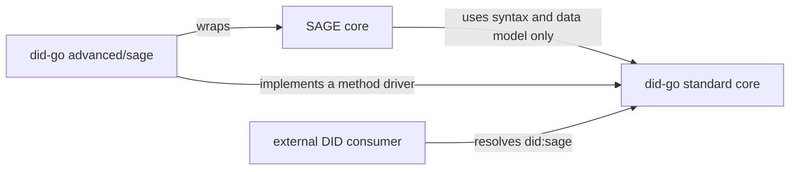
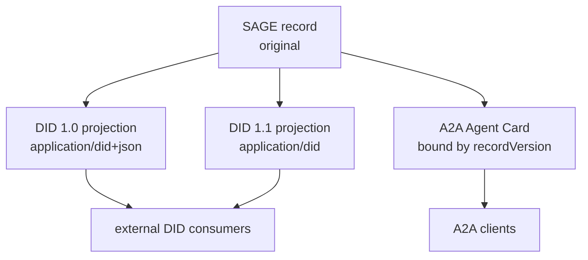

# Standard core and SAGE extension

> Written 2026-10-11. This document adds design that documents 00 to 10 leave
> open: how SAGE uses this library, how standard and SAGE-specific behavior are
> separated, and where the issuer, holder and verifier roles will sit. Where it
> revises earlier rules (09 §4, 07 §7, 05 §4 to §6), those documents were
> updated to match on 2026-10-11.

## 1. Why this document exists

Documents 00 to 10 design a Go library that supports W3C DID Core 1.0 and 1.1
together. They were written against the standards alone, so they do not say how
SAGE uses the library, how standard and SAGE features are divided, or where
issuer and verifier roles go later. This document settles those points for the
`did-go` repository.

SAGE is a trust layer for agent communication. It prevents forgery and
tampering of agent messages and defends against malicious manipulation. To
identify and manage agents, SAGE needs DIDs. As an analogy, a DID is an agent's
national identification number. Registering a key with SAGE and signing with it
to obtain non-repudiation corresponds to registering fingerprints when the
identification number is issued, and the key corresponds to the fingerprint.
That makes the DID one of the most important pieces of information in SAGE.

If this technology is not compatible with existing standards, the market will
not adopt it. A2A support, DID support and SAGE support are therefore all
mandatory, and an agent information management system that keeps the three
consistent is a central part of the design.

## 2. Principle: the standard first, SAGE as an extension

`did-go` must be a standard DID library that is useful without SAGE, and SAGE
must be able to use it as is. Features are split into two layers.

| Layer | What it does | Who uses it |
|---|---|---|
| Standard core | Fully supports DID Core 1.0 and 1.1, Controlled Identifiers 1.0 and DID Resolution. All of documents 00 to 10 belong here. | Anyone working with DIDs |
| Advanced extension | Adds rules only SAGE needs: `did:sage` resolution, the document projections SAGE defines, and the mapping between SAGE error codes and DID Resolution errors. | SAGE and services built on SAGE |

The two layers follow these rules.

1. The standard core does not know SAGE. No package in the root module imports
   SAGE or the extension module.
2. The extension does not change standard behavior. A user who does not import
   the extension sees only standard behavior. The extension plugs in by
   implementing interfaces of the standard core (method driver, validation
   profile, production options).
3. The extension can only be stricter. A SAGE profile may reject input the
   standard allows, but the extension can never make the library accept input
   the standard rejects.
4. Standard conformance tests run without the extension. If adding the
   extension changes a standard test result, that is a defect.

## 3. Repository and module layout

> The implementation package layout (players, shared types, layers) is defined by [`14`](14-implementation-architecture.md), which supersedes this section where they differ.

The package layout of 05 §1 is kept. The module path and the extension location
are as follows.

```
github.com/sage-x-project/did-go            (root module, standard core)
├── spec/ did/ document/ vm/ representation/ jsonld/
├── resolution/ (+ resolution/compat, resolution/universal)
├── method/ (+ method/key, method/web)
├── crypto/
└── advanced/
    └── sage/                                (own go.mod, advanced extension)
        ├── driver.go      did:sage method driver (wraps a SAGE core)
        ├── projection.go  produces the DID 1.0 and 1.1 projections SAGE defines
        ├── profile.go     SAGE consumption profile (stricter validation)
        └── errors.go      maps SAGE error codes to DID Resolution errors
```

- `advanced/sage` is a module with its own `go.mod`. The package graph would
  have no cycle even inside one module. The module is separate to keep the SAGE
  core, its license and its release cadence out of the root `go.mod`. A user
  who does not need `did:sage` never downloads SAGE.
- Extension module tags have the form `advanced/sage/vX.Y.Z`. During
  development the modules are combined with `go.work`; release builds do not
  use `replace`.
- A driver that uses the network, such as `did:web`, takes an injected HTTP
  client even though it lives in the root module. The root module itself never
  touches the network.
- Toolchain: Go 1.26.8, language version `go 1.26.0`.

## 4. Trust boundary: a document is not key authority

To continue the analogy, a DID string and a DID document are like an
identification number and a copy of the registration record that anyone can
look at. Showing a copy does not prove who you are. Identity is confirmed
against the registry's original record. In SAGE the registered record is that
original.

The following rules hold. They match DIDP-04 of the sage-spec proposal
`proposals/a2a-did-interop`, which is not yet adopted.

- For an operation SAGE protects, the SAGE core decides signing and
  key-agreement authority directly from the authoritative record. A DID
  document, card, cache or general-purpose resolver result handed over by a
  peer is never that basis.
- A result from the `did-go` general resolver is for display and for external
  consumers. The SAGE core imports only the syntax and data model packages of
  `did-go`; it performs resolution and key decisions itself.
- The `advanced/sage` driver goes the other way: it wraps a SAGE core and gives
  external DID consumers `did:sage` resolution results. Dependencies point one
  way only: the SAGE core points at the root module, and the extension module
  points at the SAGE core and the root module.



## 5. Agent information management

Information about one agent appears in three forms. If they disagree, both
compatibility and trust break down, so one form is the original and the others
are derived from it.

| Form | Nature | Who produces it |
|---|---|---|
| SAGE record | The original. Keys, status, services and the record version live here. | The SAGE registry and a SAGE core |
| DID documents (1.0 projection, 1.1 projection) | Copies that present the record in standard form. | A SAGE core or `advanced/sage`, using the `did-go` data model |
| A2A Agent Card | An advertisement for discovery, bound to the record by a SAGE signature. | The agent signs and publishes it; a SAGE core and the ADK verify it |



The three forms are kept consistent as follows.

1. Both DID projections are produced from one observation of the record. The
   document `id`, verification methods, relationships, services and
   `versionId` must agree; only `@context`, media type and verification method
   `type` differ (proposal DIDP-03).
2. A card carries the record version and is rejected, even with a valid
   signature, when it differs from the current record version (proposal
   A2AB-05). A changed record requires a newly signed card.
3. `did-go` is responsible for producing the projections exactly as the
   standards require and for consuming received documents by the standards.
   Card verification and protected-operation decisions stay in the SAGE cores
   and the ADK. A general tool that reads DIDs out of A2A cards is not built
   now, because A2A does not define DIDs; it will be considered as a separate
   extension if a need is shown.

This system does not take over SAGE's normative decisions (OPEN-1 to OPEN-5 of
the proposal). Until the proposal is adopted, `advanced/sage` is designed but
not implemented.

## 6. Additions to the earlier design

### 6.1 Version detection when consuming (revises 09 §4)

§6.1 (Production and Consumption) of both DID Core 1.0 and DID 1.1 requires: "A
conforming consumer MUST determine the representation of a DID document using
the Media Type input string." (the 15th statement of
production-and-consumption). The same section also requires a consumer to take
a Media Type string as input ("MUST take a representation and Media Type string
as input"), and to produce errors when it consumes a non-conforming document
("MUST produce errors when consuming non-conforming DIDs or DID documents", the
18th statement). The first revision of 2026-10-11 let the first `@context`
value decide the version when present, and when a declared DID media type
disagreed it recorded the disagreement as `Mismatch` and kept consuming. That
rule violates the MUST above, so it was revised again.

Payload inspection is limited to the case DID 1.1 §6.3.1 describes: a
low-precision media type. This path is needed because `did:web` documents
usually arrive as `application/json`. §6.3.1 is marked "This section is
non-normative", so deciding a low-precision input from its payload is a design
choice, not a spec requirement. The detection rules are as follows, and 09 §4
and 05 §4 use the same rules.

1. A declared DID media type decides the representation and the version. This
   is a MUST in both versions.
   - `application/did+json` means V10, JSON representation. DID Core 1.0 §6.2
     (JSON) does not address `@context`, and no statement in any of the specs
     makes a did+json document whose `@context` is not v1 non-conforming. The
     standard core is not stricter than the specs, so this case is not an
     error. A present `@context` is kept as a representation-specific entry
     (the DID Core 1.0 §6.1 consumer rule, rule 3 in `05` §4). If its first
     value is not `https://www.w3.org/ns/did/v1`, that value is recorded in
     `ConsumeInfo.UnexpectedContext` and consumption continues. The media type
     still decides the version and the representation. With
     `ConsumeOptions.Strict` this case is an error too.
   - `application/did+ld+json` means V10, JSON-LD representation. `@context` is
     required and its first value must be `https://www.w3.org/ns/did/v1` (DID
     Core 1.0 §6.3.1); otherwise it is an error.
   - `application/did` means V11. If `@context` is present, its first value
     must be `https://www.w3.org/ns/did/v1.1` (the DID 1.1 §6.2.3 production
     rule). Otherwise the document is non-conforming and the consumer must
     produce an error (the 18th statement of production-and-consumption). An
     `application/did` document without `@context` conforms: the JSON
     production rules of DID 1.1 §6.2.1 do not require `@context`, and the
     `@context` MUST appears only in §6.2.3, which covers production for
     JSON-LD processing. Reading the presence of `@context` in an
     `application/did` document as an intent to use JSON-LD processing, and
     therefore applying the v1.1 requirement of §6.2.3, is did-go's
     interpretation. §6.2.3 sets production rules for JSON-LD processing; it
     does not say that a present `@context` means the document is meant for
     JSON-LD processing.
   - For `application/did+ld+json` and `application/did`, a `@context` that
     does not fit the media type is an error, and there is no path that records
     a disagreement and continues. The only case that is recorded and passed is
     `UnexpectedContext` for `application/did+json`, and there too the media
     type decides the representation.
2. For a low-precision media type (`application/json`, `application/ld+json`),
   the payload decides, guided by DID 1.1 §6.3.1 (non-normative). A first
   `@context` value of `…/did/v1.1` means V11 and `…/did/v1` means V10. Without
   `@context`, `ConsumeOptions.Expected` is used; without an expected version
   the result is `VUnknown` and the document is consumed under v1.1 rules (the
   superset principle of 09 §4). In both cases without `@context`,
   `ConsumeInfo.Assumed` is set to true. In every case the received
   low-precision type and the DID media type of the detected representation are
   recorded in `ConsumeInfo.LowPrecision`.
3. Any other media type, or no media type, is an error, because a conforming
   consumer must take a media type as input.
4. A first `@context` value not covered above is an error, except that
   `application/did+json` only records it, as rule 1 says. Input that is not a
   JSON object, or input whose top-level `id` is not a valid DID, is an error
   under every media type.

`ConsumeInfo` gains `LowPrecision`, `Assumed` and `UnexpectedContext` fields.
`ConsumeOptions.Strict` turns the payload decision for low-precision input, any
version assumption, and `UnexpectedContext` on `application/did+json` input
into errors. The SAGE consumption profile uses strict mode.

This rule conflicts with the DID Resolution result example (T7 in 08 §2.2).
Example 21 of the DID Resolution v1.0 CRD (`#did-resolution-result`) pairs a DID
Core 1.0 `@context` (`https://www.w3.org/ns/did/v1`) with `contentType`
`application/did`. A consumer that follows the rule above must reject that
combination. The example is informative, so `did-go` follows the normative
MUST.

### 6.2 Resolution results and the driver contract (revises 07 §7, 05 §5 and §6)

A driver returns, in `method.ReadResult`, the document bytes together with the
media type it labels them with (`ContentType`). Each driver declares the media
types it can produce through `Produces() []string`. A resolve result
(`resolution.Result`) carries the following.

- `Raw`: the bytes returned to the caller.
- `Info`: the `representation.ConsumeInfo` obtained while consuming. Entries the
  consumer dropped from a JSON-LD representation because its `@context` does not
  define their term are listed in `Info.DroppedTerms` by location (for example
  `service[0].bar`), so a caller can see where `Raw` and `Document` differ.
- `Source`: the bytes the driver originally returned and their media type. It
  is set only when the core produced the returned bytes itself (a transcode to
  another representation, or re-production for `expandRelativeUrls`).

Because bytes are returned, a caller can verify a signature over them, or parse
them again, without trusting `did-go`'s re-serialization. If the core
transcoded, the original bytes remain in `Source`.

The core also validates the document metadata the driver supplied
(`ReadResult.Metadata`), and it does so before the `deactivated` check, so
the metadata of a deactivated result is validated too. The checks are the
following, and any violation is returned as `INVALID_DID_DOCUMENT`. Of the
constraints below, those on `equivalentId`/`canonicalId`, `deactivated` and
the datetime properties are MUSTs of DID Resolution §4.3; the type constraint
on `Extra` values is the metadata structure rule (`07` §5, DID Resolution
§7). The spec does not
require a resolver to validate driver metadata, and it does not say which
error reports a violation. Validating it, returning a violation as
`INVALID_DID_DOCUMENT`, and doing this before the `deactivated` check are
did-go policy.

- Each `equivalentId` value and `canonicalId` follow DID syntax and are DIDs
  of the same method as the resolved DID. DID Resolution §4.3 requires these
  values to conform to DID syntax and to be produced by, and a form of, the
  same DID method as the `id` property value (MUST). The resolved DID must
  equal the document `id` (step 1), so did-go compares with the resolved DID.
- The `deactivated` value is a boolean (§4.3 MUST). The Go type is `bool`, so
  this rejects a driver that puts a `deactivated` value of another type into
  `Extra`.
- `created`, `updated` and `nextUpdate` are values that can be written in the
  datetime format of `07` §3. A value with sub-second precision is rejected.
  The marshaller converts to UTC (§4.3 MUST, `07` §5).
- `versionId` and `nextVersionId` are ASCII strings (§4.3 MUST), and each
  `proof` entry is a map.
- Every `Extra` value is a type that a metadata structure allows (string,
  number, map, list, set, boolean, null), and so is every value nested in maps
  and lists (the metadata structure rules of `07` §5).

These checks follow the DID Resolution v1.0 rules whatever document version
was detected (`Metadata.Check(d, spec.V11)`). They run before the document is
consumed, and the DID Resolution v1.0 metadata structure allows numbers, so
the metadata of a driver that returns a DID Core 1.0 document may contain
numbers. DID Core 1.0 §7.3 allows no numbers, so the DID Core 1.0 path
(`resolution/compat`) converts every number in `Extra` and `proof` to a decimal
string with `V10Metadata` before it returns the metadata.

The resolve path works in this order.

1. Unless the result is deactivated, the core always runs `Consume` and
   standard validation on the bytes the driver returned, using the driver's `ContentType` as the declared media
   type. If the driver labeled the bytes with a DID media type, that type
   decides the representation, and bytes that do not conform to it are
   returned as `INVALID_DID_DOCUMENT`. Content that fails standard validation,
   and a media type caught by §6.1 rule 3, are also returned as
   `INVALID_DID_DOCUMENT`.
2. The result `contentType` is the media type of the bytes actually returned in
   `Result.Raw`. DID Resolution §4.2 defines `contentType` as "The Media Type of
   the returned didDocument", and when it is present the caller MUST use it
   when determining how to parse and process the `didDocument`. So the value is
   one of three. If the driver labeled the bytes with a DID media type and the
   driver bytes are returned, it is that DID media type. If the driver used a
   low-precision type (`application/json`, `application/ld+json`) and the
   driver bytes are returned, it is the precise DID media type of the
   representation the payload decided (§6.1 rule 2). V10 without `@context` is
   `application/did+json`, V10 with `@context` is `application/did+ld+json`,
   and V11 and VUnknown are `application/did`; the low-precision driver label
   remains in `Info.LowPrecision`. If the core transcoded in step 3, it is the
   DID media type of the representation the core produced.
3. If `accept` is empty, the driver bytes are returned unchanged. With
   `expandRelativeUrls` the bytes no longer match the document, so they are
   re-produced in the detected representation. If `accept` is present, it is
   matched with the RFC 9110 media range and
   q-value rules. DID Resolution §4.1 says the resolver SHOULD use the `accept`
   value "if such a representation is supported and available". If
   `expandRelativeUrls` is off and the representation of the bytes the driver
   returned (the detected DID media type) is acceptable, the driver bytes are
   returned as is.
   Otherwise the core checks whether it can produce an acceptable
   representation from the validated document. With the superset model and a
   Producer that takes `ProduceOptions.Version`, the core can produce all three media
   types. If it can, it transcodes, keeps the driver original in `Source`, and
   returns the produced bytes. The result `contentType` then becomes the media
   type of the produced representation.
4. If no acceptable representation can be produced, the result is
   `FEATURE_NOT_SUPPORTED`. The DID Resolution resolve algorithm has no
   representation-specific error and uses this error for an unsupported option;
   `REPRESENTATION_NOT_SUPPORTED` is defined only for the dereferencing
   `accept` option. This choice is an interpretation, and it matches the
   mapping in DIDP-05 of the sage-spec proposal. In Go it is returned as the
   error made by `resolution.NewAcceptNotSupported`. Its type is
   `FEATURE_NOT_SUPPORTED`, and `IsAcceptNotSupported` recognizes it.
   DID Core 1.0 defines `representationNotSupported` for this case, so the v1.0
   adapter recognizes this error and maps it to `representationNotSupported`
   (`09` §6.1).

The SAGE profile (`advanced/sage`) is stricter. It requires an exact match on a
single media type, accepts no q-values, and does not fall back to transcoding
(the same as DIDP-02 of the sage-spec proposal).

The extension may only make validation stricter. Neither a driver nor a profile
can disable the core validation on the resolve path. So no driver, including
`advanced/sage`, can bypass standard validation.

There is no global driver registry, and no driver registers itself as an import
side effect. Users add drivers to a resolver explicitly.

### 6.3 Input limits and security rules (supplements the NFRs of 00)

- Parsers bound input size and nesting depth, and reject duplicate JSON
  members and invalid UTF-8. Default limits are conservative and documented.
  The implemented defaults are as follows. Consumer JSON input is limited to
  1 MiB (`consumer.DefaultMaxBytes`) and a nesting depth of 100
  (`consumer.DefaultMaxDepth`), changed with `consumer.WithLimits`. Depth 100
  is above the deepest value the data model allows, so the consumer can always
  read what the producer writes. DID and DID URL input longer than 16 KiB
  (`did.MaxLength`) is rejected before parsing.
- The root module opens no network connection on its own. Packages that use the
  network use a `*http.Client` injected by the caller and limit redirects,
  response size and time. `method/web` defaults to 3 redirects
  (`WithMaxRedirects`), a 1 MiB response (`WithMaxResponseBytes`) and 10 seconds
  for the whole request (`WithTimeout`, on top of the caller's context); it
  fetches only https URLs, also after a redirect, and by default redirects must
  stay on the same host and port (`WithCrossHostRedirects`). A client whose
  transport skips TLS verification or allows a TLS version below 1.2 is refused,
  and no cookies are sent or stored. The `Client` of `resolution/universal`
  accepts only https endpoints, defaults to a 4 MiB response and 30 seconds, and
  sends no cookies. Its `Handler` reads POST bodies up to 64 KiB.
- No private key enters the library. Signing goes only through a signer
  callback. The `crypto` package of 05 §7 handles verification and key codecs
  only.
- Error messages carry neither key material nor whole documents.

### 6.4 Role layers (issuer, holder, verifier)

The layers that will later sit on the standard core get their places now. They
are not in the current implementation scope.

| Layer | Candidate packages | Notes |
|---|---|---|
| Signer interface | `signer` | No key storage |
| Securing mechanisms | `securing/jose`, later Data Integrity and SD-JWT | Uses the RFC 9864 `Ed25519` algorithm |
| Credentials | `vc/v11`, `vc/v20` | VC 2.0 is not compatible with VC 1.1, so the versions get parallel packages |
| Status lists | `status/bitstring` and others | |
| Roles | `issuer`, `holder`, `verifier` | They share no state and can be deployed separately |

Using one superset core for DIDs (ADR-11) and parallel packages for VCs may look
inconsistent. The reasons differ. DID 1.1 is a maintenance revision on the same
Recommendation track and contains 1.0, while VC 2.0 is incompatible with VC 1.1.
Credo, walt.id and SpruceID ssi added version-specific modules when they adopted
VC 2.0 for the same reason.

### 6.5 Pinned documents

DID Resolution is re-pinned to the Candidate Recommendation Draft of
2026-10-01. The resulting corrections are in 07 and 09, and the pin is listed in
[standards.md](standards.md). When DID 1.1 becomes a Recommendation, whether to
re-pin immediately or after the W3C test suites are updated will be decided
then.

## 7. ERC-8004 and staking

ERC-8004 is a Draft as of 2026-10-11 and can change at any time, so its support
has low priority. Its philosophy is still worth stating. The agent registration
part resembles A2A, but for reputation and for preventing malicious behavior it
encourages staking.

This project does not use staking as a basis for trust, for two reasons.

1. Requiring money to register makes it hard for agents with good technology to
   register.
2. If a maliciously created agent can gain more than the staked amount, the
   deterrent disappears. A monetary barrier breaks too easily under that
   condition.

The trust of `did-go` and SAGE rests on registered keys and the signatures made
with them, that is, on records that cannot be repudiated. Linking an ERC-8004
registry entry to a `did:sage` identifier will be considered only as an optional
feature, after the two-sided authenticated linkage that proposal DIDP-04 calls
for is defined. Computing reputation from signed interaction records is one
candidate approach and has not been designed.

## 8. Additional design decisions (continues 05 §11)

| # | Decision | Rationale |
|---|---|---|
| 16 | The standard core comes first; SAGE features are an opt-in advanced extension | `did-go` must be useful without SAGE and usable by SAGE as is (§2) |
| 17 | `advanced/sage` has its own `go.mod` | Keeps the SAGE core, its license and its release cadence out of the root module (§3) |
| 18 | A DID document is not key authority for a protected operation | Authority comes only from the SAGE record; same as proposal DIDP-04 (§4) |
| 19 | A declared DID media type decides the representation; the payload is inspected only for low-precision media types | The production-and-consumption MUST of DID Core 1.0 and DID 1.1; DID 1.1 §6.3.1 (non-normative). The conflict with the DID Resolution example is recorded as T7 in 08 (§6.1) |
| 20 | Resolve results keep the bytes returned (`Raw`), the detection result (`Info`) and, after transcoding, the original (`Source`); drivers state `ContentType` and the forms they can produce (`Produces`) | Signature verification without trusting re-serialization; `accept` handling (§6.2) |
| 21 | Staking is not a basis for trust or for admission | Entry barrier, and attacks whose gain exceeds the stake (§7) |
| 22 | The core consumes every driver output and runs standard validation; drivers and profiles cannot disable it | The extension can only be stricter (§2 rule 3). The result `contentType` is the media type of the bytes returned in `Result.Raw`: the DID media type the driver declared when the driver bytes are returned, or, for a low-precision label, the precise DID media type of the detected representation; if the core transcoded, the media type of the produced representation. The caller MUST parse with it (DID Resolution §4.2) (§6.2) |
| 23 | The standard core matches `accept` with RFC 9110 rules and transcodes when needed; the SAGE profile matches exactly one type and does not transcode | The SHOULD in DID Resolution §4.1 ("if such a representation is supported and available"); DIDP-02 of the sage-spec proposal (§6.2) |

## 9. Open decisions

The license was decided on 2026-10-12: Apache License 2.0, the same as
sage-spec and rs-sage-core, so that any project can import `did-go`.

- Whether `did:webvh` ships with `did:web` or waits for wider adoption.
- Whether a general extension that reads DIDs from A2A cards is needed.
- OPEN-1 to OPEN-5 of the sage-spec proposal. `advanced/sage` is not
  implemented before the proposal is adopted.
