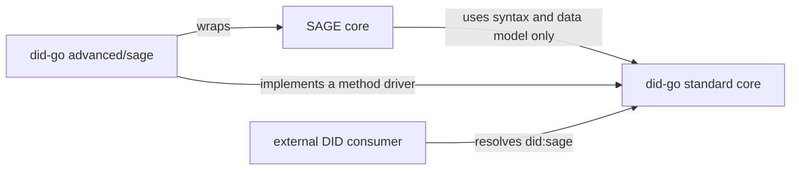
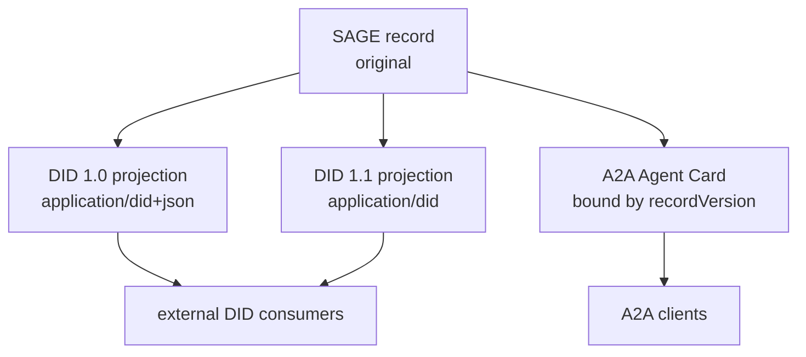

# Standard core and SAGE extension

> Written 2026-10-11. This document does not change documents 00 to 10. It
> covers what they leave open: how SAGE uses this library, how standard and
> SAGE-specific behavior are separated, and where the issuer, holder and
> verifier roles will sit.

## 1. Why this document exists

Documents 00 to 10 design a Go library that supports W3C DID Core 1.0 and 1.1
together. They were written against the standards alone, so they do not say how
SAGE uses the library, how standard and SAGE features are divided, or where
issuer and verifier roles go later. This document settles those points for the
`did-go` repository.

SAGE is a trust layer for agent communication. It prevents forgery and
tampering of agent messages and defends against malicious manipulation. To
identify and manage agents, SAGE needs DIDs. As an analogy, a DID is an agent's
national identification number. Registering a key with SAGE and signing with it
to obtain non-repudiation corresponds to registering fingerprints when the
identification number is issued, and the key corresponds to the fingerprint.
That makes the DID one of the most important pieces of information in SAGE.

If this technology is not compatible with existing standards, the market will
not adopt it. A2A support, DID support and SAGE support are therefore all
mandatory, and an agent information management system that keeps the three
consistent is a central part of the design.

## 2. Principle: the standard first, SAGE as an extension

`did-go` must be a standard DID library that is useful without SAGE, and SAGE
must be able to use it as is. Features are split into two layers.

| Layer | What it does | Who uses it |
|---|---|---|
| Standard core | Fully supports DID Core 1.0 and 1.1, Controlled Identifiers 1.0 and DID Resolution. All of documents 00 to 10 belong here. | Anyone working with DIDs |
| Advanced extension | Adds rules only SAGE needs: `did:sage` resolution, the document projections SAGE defines, and the mapping between SAGE error codes and DID Resolution errors. | SAGE and services built on SAGE |

The two layers follow these rules.

1. The standard core does not know SAGE. No package in the root module imports
   SAGE or the extension module.
2. The extension does not change standard behavior. A user who does not import
   the extension sees only standard behavior. The extension plugs in by
   implementing interfaces of the standard core (method driver, validation
   profile, production options).
3. The extension can only be stricter. A SAGE profile may reject input the
   standard allows, but the extension can never make the library accept input
   the standard rejects.
4. Standard conformance tests run without the extension. If adding the
   extension changes a standard test result, that is a defect.

## 3. Repository and module layout

The package layout of 05 §1 is kept. The module path and the extension location
are as follows.

```
github.com/sage-x-project/did-go            (root module, standard core)
├── spec/ did/ document/ vm/ representation/ jsonld/
├── resolution/ (+ resolution/compat)
├── method/ (+ method/key, method/web)
├── crypto/
└── advanced/
    └── sage/                                (own go.mod, advanced extension)
        ├── driver.go      did:sage method driver (wraps a SAGE core)
        ├── projection.go  produces the DID 1.0 and 1.1 projections SAGE defines
        ├── profile.go     SAGE consumption profile (stricter validation)
        └── errors.go      maps SAGE error codes to DID Resolution errors
```

- `advanced/sage` is a module with its own `go.mod`. The package graph would
  have no cycle even inside one module. The module is separate to keep the SAGE
  core, its license and its release cadence out of the root `go.mod`. A user
  who does not need `did:sage` never downloads SAGE.
- Extension module tags have the form `advanced/sage/vX.Y.Z`. During
  development the modules are combined with `go.work`; release builds do not
  use `replace`.
- A driver that uses the network, such as `did:web`, takes an injected HTTP
  client even though it lives in the root module. The root module itself never
  touches the network.
- Toolchain: Go 1.26.8, language version `go 1.26.0`.

## 4. Trust boundary: a document is not key authority

To continue the analogy, a DID string and a DID document are like an
identification number and a copy of the registration record that anyone can
look at. Showing a copy does not prove who you are. Identity is confirmed
against the registry's original record. In SAGE the registered record is that
original.

The following rules hold. They match DIDP-04 of the sage-spec proposal
`proposals/a2a-did-interop`, which is not yet adopted.

- For an operation SAGE protects, the SAGE core decides signing and
  key-agreement authority directly from the authoritative record. A DID
  document, card, cache or general-purpose resolver result handed over by a
  peer is never that basis.
- A result from the `did-go` general resolver is for display and for external
  consumers. The SAGE core imports only the syntax and data model packages of
  `did-go`; it performs resolution and key decisions itself.
- The `advanced/sage` driver goes the other way: it wraps a SAGE core and gives
  external DID consumers `did:sage` resolution results. Dependencies point one
  way only: the SAGE core points at the root module, and the extension module
  points at the SAGE core and the root module.



## 5. Agent information management

Information about one agent appears in three forms. If they disagree, both
compatibility and trust break down, so one form is the original and the others
are derived from it.

| Form | Nature | Who produces it |
|---|---|---|
| SAGE record | The original. Keys, status, services and the record version live here. | The SAGE registry and a SAGE core |
| DID documents (1.0 projection, 1.1 projection) | Copies that present the record in standard form. | A SAGE core or `advanced/sage`, using the `did-go` data model |
| A2A Agent Card | An advertisement for discovery, bound to the record by a SAGE signature. | The agent signs and publishes it; a SAGE core and the ADK verify it |



The three forms are kept consistent as follows.

1. Both DID projections are produced from one observation of the record. The
   document `id`, verification methods, relationships, services and
   `versionId` must agree; only `@context`, media type and verification method
   `type` differ (proposal DIDP-03).
2. A card carries the record version and is rejected, even with a valid
   signature, when it differs from the current record version (proposal
   A2AB-05). A changed record requires a newly signed card.
3. `did-go` is responsible for producing the projections exactly as the
   standards require and for consuming received documents by the standards.
   Card verification and protected-operation decisions stay in the SAGE cores
   and the ADK. A general tool that reads DIDs out of A2A cards is not built
   now, because A2A does not define DIDs; it will be considered as a separate
   extension if a need is shown.

This system does not take over SAGE's normative decisions (OPEN-1 to OPEN-5 of
the proposal). Until the proposal is adopted, `advanced/sage` is designed but
not implemented.

## 6. Additions to the earlier design

### 6.1 Version detection when consuming (supplements 09 §4)

09 §4 looks at the media type first and `@context` second. Real input often has
a media type that disagrees with its content. The DID Resolution result example
sends a 1.0 `@context` as `application/did`, and `did:web` documents usually
arrive as `application/json`. DID 1.1 §6.3.1 discourages raising errors when
the intended media type can be determined from the payload. Detection is
therefore refined as follows.

1. If `@context` is present, its first value decides: `…/did/v1` is V10 and
   `…/did/v1.1` is V11. A declared DID media type that disagrees is recorded in
   `ConsumeInfo` as a mismatch, not raised as an error.
2. If `@context` is absent, `application/did+json` means V10 and
   `application/did` means V11.
3. If the media type is a low-precision one (`application/json`,
   `application/ld+json`) and there is no `@context`, the version the caller
   expects is used. Without an expected version the result is `VUnknown` and the
   document is consumed under v1.1 rules (the superset principle of 09 §4).
   `ConsumeInfo` records that the version was assumed.
4. Any other first `@context` value, input that is not a JSON object, or input
   whose top-level `id` is not a valid DID is an error.

`ConsumeInfo` gains `Mismatch` and `Assumed` fields. A strict option turns every
mismatch and assumption into an error. The SAGE consumption profile uses strict
mode.

### 6.2 Resolution results keep the original bytes (supplements 07 §7)

A resolve result returns the document bytes exactly as the driver produced
them, together with their `contentType`. The parsed `Document` and the detection
information sit beside them. With the original bytes a caller can verify a
signature over them, or parse them again, without trusting `did-go`'s
re-serialization.

Each driver declares the versions and media types it can produce. When the
resolver receives an `accept` value the driver cannot produce, it refuses with
`FEATURE_NOT_SUPPORTED` before calling the driver. The DID Resolution resolve
algorithm has no representation-specific error and uses this error for an
unsupported option; `REPRESENTATION_NOT_SUPPORTED` is defined only for the
dereferencing `accept` option. This choice is an interpretation, and it matches
the mapping in DIDP-05 of the sage-spec proposal. There is no global driver
registry, and no driver registers itself as an import side effect. Users add
drivers to a resolver explicitly.

### 6.3 Input limits and security rules (supplements the NFRs of 00)

- Parsers bound input size and nesting depth, and reject duplicate JSON
  members and invalid UTF-8. Default limits are conservative and documented.
- The root module performs no network I/O. Drivers that use the network take an
  injected HTTP client and limit redirects, response size and time.
- No private key enters the library. Signing goes only through a signer
  callback. The `crypto` package of 05 §7 handles verification and key codecs
  only.
- Error messages carry neither key material nor whole documents.

### 6.4 Role layers (issuer, holder, verifier)

The layers that will later sit on the standard core get their places now. They
are not in the current implementation scope.

| Layer | Candidate packages | Notes |
|---|---|---|
| Signer interface | `signer` | No key storage |
| Securing mechanisms | `securing/jose`, later Data Integrity and SD-JWT | Uses the RFC 9864 `Ed25519` algorithm |
| Credentials | `vc/v11`, `vc/v20` | VC 2.0 is not compatible with VC 1.1, so the versions get parallel packages |
| Status lists | `status/bitstring` and others | |
| Roles | `issuer`, `holder`, `verifier` | They share no state and can be deployed separately |

Using one superset core for DIDs (ADR-11) and parallel packages for VCs may look
inconsistent. The reasons differ. DID 1.1 is a maintenance revision on the same
Recommendation track and contains 1.0, while VC 2.0 is incompatible with VC 1.1.
Credo, walt.id and SpruceID ssi added version-specific modules when they adopted
VC 2.0 for the same reason.

### 6.5 Pinned documents

DID Resolution is re-pinned to the Candidate Recommendation Draft of
2026-10-01. The resulting corrections are in 07 and 09, and the pin is listed in
[standards.md](standards.md). When DID 1.1 becomes a Recommendation, whether to
re-pin immediately or after the W3C test suites are updated will be decided
then.

## 7. ERC-8004 and staking

ERC-8004 is a Draft as of 2026-10-11 and can change at any time, so its support
has low priority. Its philosophy is still worth stating. The agent registration
part resembles A2A, but for reputation and for preventing malicious behavior it
encourages staking.

This project does not use staking as a basis for trust, for two reasons.

1. Requiring money to register makes it hard for agents with good technology to
   register.
2. If a maliciously created agent can gain more than the staked amount, the
   deterrent disappears. A monetary barrier breaks too easily under that
   condition.

The trust of `did-go` and SAGE rests on registered keys and the signatures made
with them, that is, on records that cannot be repudiated. Linking an ERC-8004
registry entry to a `did:sage` identifier will be considered only as an optional
feature, after the two-sided authenticated linkage that proposal DIDP-04 calls
for is defined. Computing reputation from signed interaction records is one
candidate approach and has not been designed.

## 8. Additional design decisions (continues 05 §11)

| # | Decision | Rationale |
|---|---|---|
| 16 | The standard core comes first; SAGE features are an opt-in advanced extension | `did-go` must be useful without SAGE and usable by SAGE as is (§2) |
| 17 | `advanced/sage` has its own `go.mod` | Keeps the SAGE core, its license and its release cadence out of the root module (§3) |
| 18 | A DID document is not key authority for a protected operation | Authority comes only from the SAGE record; same as proposal DIDP-04 (§4) |
| 19 | A mismatch between media type and `@context` is recorded, and is an error only in strict mode | DID 1.1 §6.3.1 and the DID Resolution example (§6.1) |
| 20 | Resolve results keep the original bytes and `contentType`; drivers declare the forms they can produce | Signature verification without trusting re-serialization; `accept` handling (§6.2) |
| 21 | Staking is not a basis for trust or for admission | Entry barrier, and attacks whose gain exceeds the stake (§7) |

## 9. Open decisions

- License. `did-go` starts under LGPL-3.0 to match the SAGE Go core. Apache-2.0
  would match sage-spec and rs-sage-core and is easier for wide adoption.
  Changing it becomes hard after outside contributions arrive.
- Whether `did:webvh` ships with `did:web` or waits for wider adoption.
- Whether a general extension that reads DIDs from A2A cards is needed.
- OPEN-1 to OPEN-5 of the sage-spec proposal. `advanced/sage` is not
  implemented before the proposal is adopted.
