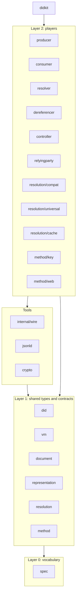

# Implementation architecture: shared types and separated players

> Written 2026-10-12, before any code, and revised the same day after an
> adversarial review. This document fixes how the design of 00 to 12 becomes Go
> packages. Where it renames, splits or changes a package or type named in 03,
> 05, 07, 09 or 12, this document is the reference and those documents point
> here.

## 1. Goals

1. **Importable.** A Go project imports only the packages it needs. A project
   that only parses DIDs pulls in `did` and nothing else; a project that uses
   only `did:key` never pulls in `net/http`. No package registers itself as an
   import side effect, and no package keeps global mutable state.
2. **Players are separated.** Each role in the DID architecture is its own
   package: producer, consumer, DID resolver, DID URL dereferencer, DID method
   drivers, DID controller and relying party. A player never imports another
   player; players meet only through shared interfaces.
3. **One set of types and data formats.** Every player uses the same types for
   DIDs, documents, verification methods, services, metadata, options, results
   and errors. These are defined first, in layers that contain no player logic.
4. **Spec-driven.** Every behavior traces to a pinned specification statement,
   and every in-scope normative statement has at least one test or vector that
   names it.
5. **Verifiable per version.** An external inspector can test DID Core 1.0 and
   DID 1.1 behavior separately through the public API, and a later DID version
   can be added.

## 2. Layers



Import rules, checked by the architecture test (§7.3):

- Layer 0 imports only the standard library.
- Layer 1 imports layer 0, the standard library and other layer-1 packages
  without cycles. It contains no I/O, no goroutines and no global mutable
  state.
- Tools import layers 0 and 1 and the standard library. They are helpers, not
  roles: `internal/wire` (the property-name table and INFRA-value-to-JSON
  conversion shared by producer and consumer), `jsonld` (embedded base contexts
  and their SHA-256), `crypto` (Multikey and JWK codecs).
- Layer 2 imports layers 0 and 1 and tools. A layer-2 package never imports
  another layer-2 package.
- `didkit` imports players to assemble them and contains no logic.
- Nothing in the root module imports `advanced/...`.

## 3. Layer 0: `spec`

`spec` is the only place where version-specific facts live:

- `Version` with `V10`, `V11` and `VUnknown`; `String()`, `ParseVersion("1.0")`,
  `Supported() []Version` and `Latest`. `VUnknown` means "not determined", and
  each player states which profile it applies to it (consumers apply `Latest`,
  09 §4); the zero value never silently means a specific version.
- The profile table: per version, the context URL, the media types it produces
  and accepts, the production rules that differ (for example `service.id`
  required in V10), and the list of terms defined by that version's base
  context (used for the V10 "undefined property" warning and for JSON-LD term
  handling).
- Specification keys for requirement ids. Each key names an exact snapshot
  (`core10` for DID Core 1.0 REC, `did11-cr20260305`, `cid10`,
  `res10-crd20261001`, `didkey-2cc490c`, `didweb-ea423c1`), so that conformance
  is always measured against a named publication. A conformance profile is a
  tuple of keys, for example {`did11-cr20260305`, `cid10`, `res10-crd20261001`}.

`representation` and `jsonld` read media types, context URLs and term lists
from `spec`; they do not define their own copies.

## 4. Layer 1: shared types and contracts

| Package | Contains | Imports |
|---|---|---|
| `did` | `DID`, `DIDURL`, ABNF parsing, relative DID URL resolution, `DIDParameters` as parsed values. | none |
| `vm` | `Method` (verification method), `Relationship`, `Purpose`, `Service`, `Endpoint`, the Multikey prefix table, value-level checks (06). | `did` |
| `document` | Immutable `Document` with copy-returning accessors (`ID`, `Controllers`, `AlsoKnownAs`, `VerificationMethods`, `Relationship`, `Services`, `Extensions`, `RepresentationEntries`); `Builder` (including `Extension` and `RepresentationEntry`); INFRA `Map` and `Value`; `Metadata` (didDocumentMetadata) with its JSON encoding; `Validate(d, v spec.Version) []Finding`; the pure selector `SelectMethod(d, ref did.DIDURL, p vm.Purpose) (*vm.Method, *ConformanceError)` with the CID error codes. | `did`, `vm`, `spec` |
| `representation` | Media type helpers that read `spec`; `Producer` and `Consumer` interfaces; `ProduceOptions{Version, ...}`; `ConsumeOptions{Expected, Require, Strict}`; `ConsumeInfo`, `LowPrecision`; the detection rule as a pure function (09 §4). | `spec`, `document` |
| `resolution` | `Resolver` and `Dereferencer` interfaces; `ResolutionOptions` (including `NoCache`), `ResolutionMetadata`, `Result`, `SourceBytes`, `DereferenceOptions`, `DereferenceResult`; `Error` (RFC 9457) built by `NewError(code Code, detail string)`, with `Code` constants, `Refines`, `HTTPStatus` and `(*Error).Is` comparing types; `DocumentMetadata` as an alias of `document.Metadata`. | `did`, `document`, `representation`, `spec` |
| `method` | The `Method` interface (05 §5), `ReadResult`, `ReadOptions`, create, update and deactivate options and results, `Signer{ Sign(ctx, msg) ([]byte, error); KeyID() did.DIDURL }`, errors, and an immutable `Registry` built by `NewRegistry(ms ...Method) (*Registry, error)`. | `did`, `document` |

Rules for layer 1:

- **Data formats are decided once.** JSON names of metadata, option and error
  fields, the datetime format (UTC, whole seconds, 07 §3), metadata value types
  (07 §5), error type URLs (07 §4) and media type strings exist only here and
  in `spec`. Layer 1 may implement `encoding/json` for its own metadata, option
  and error types. DID document representations are produced only by the
  `producer` player and read only by the `consumer` player.
- **Values are immutable.** Constructors validate and return a value or an
  error; accessors return copies; `Builder` produces a new `Document`.
- **No shared mutable values.** Errors are created per use with `NewError`;
  exported collections are functions that return fresh slices.

## 5. Layer 2: players and the spec entity each one is

| Player | Package | Spec entity or role | Notes |
|---|---|---|---|
| Producer | `producer` | Conforming producer (DID Core §1.4, §6) | Implements `representation.Producer` for each profile in `spec`. |
| Consumer | `consumer` | Conforming consumer (DID Core §1.4, §6) | Implements `representation.Consumer`; detection, `Require`, strict mode. |
| DID resolver | `resolver` | DID resolver (DID Resolution) | `DefaultResolver` takes a `method.Registry`, a `representation.Consumer` and a `representation.Producer`. |
| DID URL dereferencer | `dereferencer` | DID URL dereferencer (DID Resolution) | Owns the DID parameter algorithm and the mapping from `DIDParameters` to options; takes any `resolution.Resolver` and a `representation.Producer`; uses `document.SelectMethod`. |
| DID method drivers | `method/key`, `method/web` | Implementations of method specifications | Each driver takes a `representation.Producer` at construction (`key.New(p)`), so it serializes without importing a player. `did:web` also takes an `*http.Client` with limits. |
| DID controller | `controller` | Architecture role (DID Core appendix B) | Create, update, deactivate through a `method.Method`, using a `method.Signer`. Holds no key. |
| Relying party | `relyingparty` | Architecture role; CID verification method retrieval | Takes a `resolution.Dereferencer`; rejects deactivated results; returns the selected `vm.Method`. Proof verification of any credential format is out of scope. |
| v1.0 adapter | `resolution/compat` | DID Core 1.0 §7 abstract functions | `V10Resolver`, `V10Dereferencer` over the interfaces (09 §6). |
| HTTPS binding | `resolution/universal` | DID Resolution §12 | Transport only: a client implementing `Resolver` and `Dereferencer`, and an `http.Handler` exposing any resolver. |
| Cache | `resolution/cache` | DID Resolution caching (§4.1 `noCache`) | A `Resolver` decorator. |

Statements of the "conforming DID method" class constrain method
specification authors, not this library, and are recorded as
`out-of-scope: spec-author`. The drivers' own obligations come from the pinned
`did:key` and `did:web` specifications (§8).

## 6. Wiring

`didkit` takes `method.Method` values from the caller and never imports a
driver itself, so a `did:key` user does not pull in `net/http`:

```go
p := producer.New()
r, err := didkit.NewResolver(key.New(p))                // did:key only
r, err = didkit.NewResolver(key.New(p), web.New(p, hc)) // adds did:web
```

`didkit` does not include `resolution/compat`; legacy callers wrap a resolver
themselves.

## 7. Spec-driven development

### 7.1 Requirement registry

`conformance/requirements.json` lists every normative statement of the pinned
specifications, extracted by `tools/xbar/extract_spec.py` from the bytes whose
SHA-256 is in [standards.md](standards.md). Each entry has:

- `id` (for example `res10-crd20261001#resolving-algorithm.3`), `text` and
  `textSHA256`;
- `scope`: `in-scope`, or `out-of-scope` with a reason such as `spec-author`
  or `informative` (from the coverage review in [13](13-xbar-verification.md));
- `owners`: the package paths responsible (type packages included, for example
  `did` for conforming-DID statements);
- `design`: the design section that restates it.

When a new publication is pinned, re-extraction writes a remap file from old to
new ids, matched on text, so that test references can be updated mechanically.

### 7.2 Tests and vectors name requirements

A test names the statements it checks in a string literal, usually the subtest
name; vector files under `testdata/` carry a `statements` array. The coverage
check (`conformance/coverage_test.go`) parses test files with `go/ast` and
collects every string literal that matches a registry key pattern, reads the
vector files, and fails when:

- an `in-scope` statement has no reference while all its owner packages exist;
- a reference names an id that is not in the registry;
- a statement's `textSHA256` differs from the pinned text it was written for.

Work proceeds statement by statement: write the failing test that names the
statement, implement, repeat.

### 7.3 Architecture test

`internal/archtest` reads the imports of every package with `go/build` and
fails on any import the rules of §2 do not allow.

### 7.4 What is published for inspectors

The exported package `conformance` provides `Requirements()` (the registry) and
`Claims(profile)` (which statement ids are implemented for a conformance
profile and which are answered with `FEATURE_NOT_SUPPORTED`). An inspector
extracts statements itself from the specification bytes and cross-checks the
SHA-256, so it never trusts did-go's registry as the oracle.

## 8. Versions, inspection and DID 2.0

The public API offers what an external inspector needs to test each version
separately, without internal packages:

- `ProduceOptions.Version` to produce one version's representation;
- `ConsumeOptions.Require` to reject input of any other version, so DID Core
  1.0 consumption can be tested on its own;
- `document.Validate(d, v)` returning findings that carry statement ids;
- `resolution/compat` for the DID Core 1.0 resolution functions;
- the document accessors of §4.

Adding a version:

- An additive version (the superset relation of ADR-11 still holds) is a new
  profile in `spec`, its embedded context in `jsonld`, its detection rule, and
  its requirement keys.
- A version that breaks the superset relation changes `resolution.Result`,
  which carries a `*document.Document`, and with it every player that reads a
  document. Such a version ships as a new major module (`/v2`) or as a parallel
  package set, not as a silent change to the existing players.

## 9. Method specifications pinned

| Key | Specification | Status | Pinned revision | SHA-256 of `index.html` |
|---|---|---|---|---|
| `didkey-2cc490c` | [did:key](https://github.com/w3c-ccg/did-key-spec) | W3C CCG draft | `2cc490c38c5aacf58497a87fc0cf8794668bf716` (2025-11-02) | `e014a146acb0dcdafbdfee01226061d778da3ee72e8a048a7d53754c79675764` |
| `didweb-ea423c1` | [did:web](https://github.com/w3c-ccg/did-method-web) | W3C CCG draft | `ea423c114e6f2537498ee6f94e8d794c64f60c18` (2026-05-08) | `7e48b1ad2d658452bc9ce23b975d243abe095f7696c06671fc332705a1290610` |

Both are community drafts and can change; a new revision is pinned as a new
key.

## 10. Order of implementation

1. Layer 0 and layer 1, complete, with tests, and the registry, coverage and
   architecture tests. All players depend on these, so they are finished and
   reviewed before any player starts.
2. Tools: `internal/wire`, `jsonld`, `crypto`.
3. `producer` and `consumer`.
4. `resolver`, `dereferencer`, `resolution/compat`, `resolution/cache`.
5. `method/key`, then `method/web` and `resolution/universal`.
6. `controller`, `relyingparty`, `didkit`.

Players of the same step share only layers 0 and 1 and tools, so they can be
written in parallel.

## 11. Changes to earlier documents

- 05 §1, 03: `resolution` holds types and interfaces only; `DefaultResolver`
  moves to `resolver`; producer and consumer logic moves from `representation`
  to `producer` and `consumer`, while `representation` keeps the interfaces,
  options and detection rule; version facts move to `spec`; DID parameters and
  dereferencing move from `resolution/universal` to `dereferencer`; caching
  becomes `resolution/cache`.
- 05 §3: `Document` gains copy-returning accessors and `Builder.Extension` and
  `Builder.RepresentationEntry`; `document.Profile` is replaced by
  `Validate(d, v)`; `SelectMethod` is the single selector.
- 05 §5: `Registry` becomes immutable; `method.Signer` is added.
- 05 §6, 07 §7: error sentinels become `Code` constants with `NewError`;
  `ResolutionOptions` gains `NoCache`.
- New players `controller`, `relyingparty`, `dereferencer`, `resolution/cache`;
  wiring package `didkit`; tools layer.
- 12 §3: the SAGE extension remains `advanced/sage` and plugs into these
  contracts like any other driver and profile.
