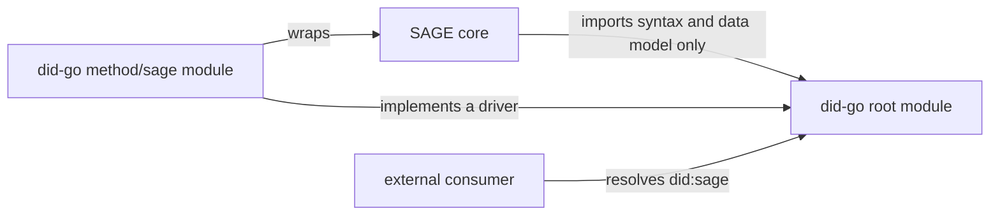

# did-go design

did-go is a Go library for W3C Decentralized Identifiers. It supports DID Core
1.0 and DID 1.1 side by side, resolves DIDs through method plugins, and is
designed to grow issuer, holder and verifier roles on the same lower layers.
SAGE consumes it, but it does not depend on SAGE and it is useful without
SAGE.

This document fixes the goals, the layers, the version policy and the
boundary with SAGE before any code is written. It is a design, not a
conformance claim.

## Why a separate project

DID support is more than one parsing module. The W3C stack separates roles
(issuer, holder, verifier and the resolver they all use), and the standards
move on their own schedule: DID 1.1 is a Candidate Recommendation and DID
Resolution is still a draft. SAGE's normative baseline is frozen at 0.10.0 and
its evidence is tied to that revision. Keeping DID work in its own repository
lets it follow the W3C documents without reopening SAGE core or its evidence.

The cost is one more repository and release line, and a compatibility matrix
between SAGE core and did-go that has to be maintained.

## Standards baseline

| Document | Status used | Role in did-go |
|---|---|---|
| [DID Core 1.0](https://www.w3.org/TR/2022/REC-did-core-20220719/) | Recommendation, 2022-07-19 | 1.0 data model, JSON and JSON-LD representations |
| [DID 1.1](https://www.w3.org/TR/did-1.1/) | Candidate Recommendation Snapshot, 2026-03-05 | 1.1 data model, `application/did` |
| [Controlled Identifiers 1.0](https://www.w3.org/TR/cid-1.0/) | Recommendation, 2025-05-15 | `Multikey` and `JsonWebKey` verification methods used by DID 1.1 |
| [DID Resolution](https://www.w3.org/TR/did-resolution/) | Candidate Recommendation Draft, 2026-10-01 | resolver contract, metadata and errors |
| [RFC 9457](https://www.rfc-editor.org/rfc/rfc9457) | Proposed Standard | problem details for resolution errors |
| [RFC 8785](https://www.rfc-editor.org/rfc/rfc8785), [RFC 7515](https://www.rfc-editor.org/rfc/rfc7515), [RFC 9864](https://www.rfc-editor.org/rfc/rfc9864) | Published RFCs | canonical JSON, JWS, the fully specified `Ed25519` algorithm |

Each implementation change cites the dated text it follows. When a draft
changes, the pinned date moves in a separate change with its own tests, so a
reader can tell which behavior follows which text. Dated URLs and digests for
these documents are recorded in the
[sage-spec proposal basis](https://github.com/SAGE-X-project/sage-spec/blob/main/proposals/a2a-did-interop/basis.json).

## Goals

1. Parse and validate DID syntax and DID URLs. The ABNF is the same in 1.0 and
   1.1, so one syntax parser serves both. The meaning of DID parameters is
   not version-neutral: 1.0 defines them in §3.2.1, while 1.1 moved them to
   DID Resolution. Parameter semantics therefore live in `resolution`, not in
   the parser.
2. Produce and consume DID documents in both versions without silently
   converting one into the other.
3. Resolve a DID through a method plugin and return the result that DID
   Resolution defines: a document, resolution metadata and document metadata,
   with errors as RFC 9457 problem details.
4. Give verifiers a version-neutral, read-only view of verification methods
   and verification relationships, so the same document content yields the
   same verification decision whichever version it was written in.
5. Keep private keys out of the library. Anything that signs takes a signer
   callback, the same way the SAGE signer keeps keys in a separate process.

## Non-goals

- Deciding trust. did-go reports what a document and its method say. Which
  controllers, registries or anchors to trust is the caller's decision.
- Key custody. did-go defines a signer interface and does not ship a key
  store.
- JSON-LD processing. did-go reads and writes the JSON form, compares
  `@context` values as exact strings, and does not expand or compact JSON-LD.
  A caller that needs JSON-LD semantics can run a processor on the bytes.
- The SAGE protected path. SAGE core keeps deciding identity and keys for
  protected operations by its own rules; see the boundary section.

## Layers and roles

A package imports only packages in earlier rows of this table.

| Layer | Planned packages | In the first scope |
|---|---|---|
| Syntax | `did` | yes |
| Controlled identifiers | `cid` | yes |
| Data model | `document/core10`, `document/core11` | yes |
| Version-neutral view | `document` | yes |
| Resolution | `resolution` | yes |
| Method plugins | `method/key`, `method/web`, later `method/webvh` and `method/sage` | `key`, then `web` |
| Key access | `signer` | interface only |
| Securing mechanisms | `securing/jose`, later Data Integrity and SD-JWT | no |
| Credentials | `vc/v11`, `vc/v20` | no |
| Status | `status/bitstring` and others | no |
| Roles | `issuer`, `holder`, `verifier` | no |

The role packages come after the first scope and are built only on the
earlier rows, so an issuer and a verifier can be deployed separately without
sharing state.

Credential versions follow the same parallel-package rule as DID versions.
Credo, walt.id and SpruceID ssi adopted VC 2.0 by adding version-specific
modules beside their 1.1 ones; Veramo kept one model and still has the 1.1
shape. did-go takes the parallel route.

## Version policy

**Parallel packages.** `core10` and `core11` are separate types with separate
validation. Neither is a superset of the other. A document that carries
`@context` can belong to only one of them: 1.0 JSON-LD starts it with
`https://www.w3.org/ns/did/v1` and 1.1 with `https://www.w3.org/ns/did/v1.1`.
A document without `@context` is legitimate in both: 1.0 requires `@context`
only for JSON-LD production (DID Core 1.0 §6.3.1), and 1.1 requires it only
for JSON-LD processing (DID 1.1 §6.2.3). Such a document parses under either
model, which is why the consuming rules below record how the version was
chosen.

**Producing.** The caller chooses the version. 1.0 output declares
`application/did+json` or `application/did+ld+json`; 1.1 output declares
`application/did`. did-go never picks a version on the caller's behalf.

**Consuming.** Real input does not keep media type and content consistent.
DID Resolution's own result example pairs a 1.0 `@context` with
`application/did`, and `did:web` documents are usually served as
`application/json`. DID 1.1 §6.3.1 discourages raising errors when the
intended media type can be determined from the payload. The parser therefore
chooses the model in this order and returns, with the document, how it chose:

1. If `@context` is present, its first value decides: `v1` selects 1.0 and
   `v1.1` selects 1.1. A declared DID media type that disagrees is reported
   as a mismatch in the result, not raised as an error.
2. If `@context` is absent, a declared `application/did` selects 1.1 and
   `application/did+json` selects 1.0.
3. If the media type is a low-precision one (`application/json`,
   `application/ld+json`) and there is no `@context`, the version the caller
   expects is used; without one, 1.0 is used. The result is marked as assumed.
4. Any other first `@context` value, or a payload that is not a JSON object
   with a top-level `id` holding a valid DID, is an error.

A strict option turns every mismatch and assumption into an error, for
callers that must not accept anything imprecise.

**Conversion.** Converting between versions is an explicit function. It
returns the converted document together with the members it could not carry
or had to map, for example a verification method type that the target version
does not define. Mapping `JsonWebKey2020` to `JsonWebKey` is one such case and
is reported, not done silently. Callers that need lossless output check that
list.

**View.** `document.View` lists verification methods per relationship, with
the key material in one normalized form, and records which version it came
from. It is built from either model. Verifiers depend on the view, not on a
version.

**Deprecation.** When DID 1.1 becomes a Recommendation, 1.0 support stays. It
can be removed only in a major release, announced at least one minor release
ahead.

## Resolution contract

`resolution.Resolver` takes a DID and options, including `accept`, and returns
a result with four parts:

- the document bytes exactly as the driver produced them, and their
  `contentType`;
- the parsed document as a tagged value that holds either a `core10` or a
  `core11` document, together with how the version was chosen;
- resolution metadata;
- document metadata.

A `View` can be built from the parsed document. Keeping the original bytes
lets a caller verify signatures over them, or re-parse them, without trusting
did-go's re-serialization.

Method plugins implement a `method.Driver` interface. Each driver declares
the DID versions and media types it can produce, and the resolver refuses an
`accept` value that the driver cannot satisfy. Drivers are registered with a
resolver explicitly. There is no global registry and no plugin registered as
an import side effect.

Resolution errors use the types the pinned draft's resolution algorithm
names: `INVALID_DID`, `INVALID_OPTIONS`, `METHOD_NOT_SUPPORTED`,
`FEATURE_NOT_SUPPORTED`, `NOT_FOUND` and `INVALID_DID_DOCUMENT`, as type URIs
under `https://www.w3.org/ns/did#`. The draft says implementers SHOULD use
RFC 9457 problem details; did-go always does. An option the resolver does not
support is refused with `FEATURE_NOT_SUPPORTED`, not ignored. A deactivated
DID returns no document and sets `deactivated` to `true` in document
metadata; when `deactivated` is present for an active DID it is `false`. The
HTTP status mapping, including 410 for a deactivated DID, is copied from the
pinned draft when the package is written.

DID URL dereferencing (fragments, services, paths) is not in the first
scope. It comes after the `did:key` driver and brings its own errors,
`INVALID_DID_URL` and `REPRESENTATION_NOT_SUPPORTED`, which the draft defines
for dereferencing.

## Boundary with SAGE

- The root module has no dependency on SAGE.
- SAGE core may import the syntax and data model packages to read and write
  documents. It does not take a did-go resolution result as the basis for a
  protected decision, so the looser rules of a general resolver never enter
  the SAGE protected path.
- The `did:sage` driver lives in its own Go module, `method/sage` with its own
  `go.mod`, which imports SAGE core. The package graph would have no cycle
  even in one module. The separate module keeps SAGE, and its license and
  release cadence, out of the root `go.mod`, so a consumer that does not use
  `did:sage` never downloads SAGE. The driver module is tagged
  `method/sage/vX.Y.Z` and uses a `go.work` file during development; release
  builds do not use `replace`.
- The `did:sage` driver is written only after the sage-spec A2A and DID
  interoperability proposal is adopted, and it follows the adopted text.

## Security rules

- Parsers bound input size and nesting depth, reject duplicate JSON members
  and reject invalid UTF-8.
- The root module performs no network I/O. A driver that fetches, such as
  `did:web`, takes an injected HTTP client and limits redirects, response size
  and time. The defaults are conservative and documented.
- No private key enters the library. Signing goes through the `signer`
  interface.
- Error messages do not echo key material or whole documents.

## Testing

- Table tests built from the examples in the pinned specification texts, each
  citing its source section.
- A positive and a negative case for every validation rule.
- Fuzz tests for the DID, DID URL and document parsers.
- Later, the W3C DID Resolution test suite against the resolver.
- CI runs gofmt, go vet, golangci-lint and `go test -race`, and fails below
  90% statement coverage, as the other SAGE Go repositories do.
- Go 1.26.8 toolchain with the `go 1.26.0` language version.

## Milestones

1. DID and DID URL syntax; the `core10` and `core11` models with JSON
   production and consumption; the view.
2. The resolution contract and the `did:key` driver.
3. DID URL dereferencing, and the `did:web` driver with an injected HTTP
   client.
4. The `did:sage` driver module, after the sage-spec proposal is adopted.
5. The signer interface and JOSE securing, then the VC models and the issuer,
   holder and verifier roles.

## Open decisions

- License. The repository starts under LGPL-3.0 to match the SAGE Go core.
  Apache-2.0 would match sage-spec and rs-sage-core and eases wider adoption.
  Changing it becomes hard once outside contributions arrive.
- Whether `did:webvh` joins milestone 3 or waits for wider adoption.
- Whether the `did:sage` driver lives here or in the `sage` repository.
- When DID 1.1 reaches Recommendation, whether to re-pin immediately or after
  the W3C test suites are updated.
